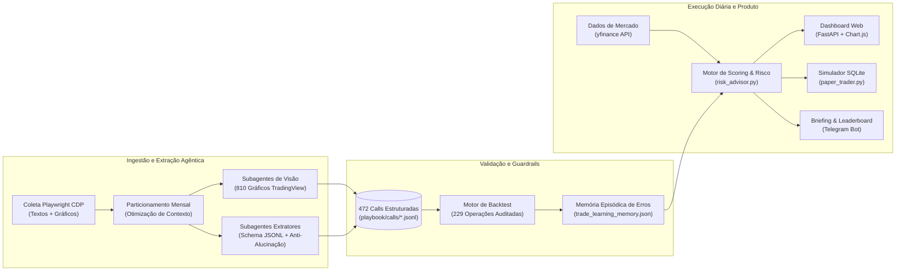

# Mental Hedge OS — Quantitative Macro & Multi-Agent Decision System

Sistema de apoio à decisão financeira e simulação de carteira (*paper trading*) que combina **extração estruturada com múltiplos agentes de IA (texto e visão)** e **motores determinísticos de gestão de risco em Python**.

O projeto nasceu de um problema prático: análises macroeconômicas e de criptoativos publicadas em redes sociais costumam misturar teses estruturadas (com ponto de entrada, invalidação e tamanho de posição) com comentários opinativos do dia a dia. O objetivo foi construir um pipeline capaz de separar sinal de ruído, validar estatisticamente o que realmente funcionou contra dados históricos de mercado e transformar essas regras em um consultor automatizado focado em preservação de capital.

---

## Arquitetura do Sistema

Uma decisão arquitetural importante do projeto foi **não delegar o cálculo de risco diretamente a um LLM em tempo de execução**. Em vez disso, o sistema foi dividido em duas camadas:

1. **Camada Offline (Ingestão Multimodal & Agentes de Extração):**
   - Coleta automatizada via `Playwright` conectando na porta de debug do navegador (CDP) para recuperar postagens e gráficos técnicos do TradingView.
   - Particionamento temporal em lotes mensais (`playbook/split_months.py`) para evitar estourar a janela de contexto e reduzir consumo de tokens.
   - Orquestração de subagentes em paralelo: um fluxo dedicado à leitura visual/OCR de **810 gráficos técnicos** e outro dedicado à extração semântica de **3.589 publicações** seguindo o contrato definido em [`playbook/EXTRACTION_GUIDE.md`](playbook/EXTRACTION_GUIDE.md) (exigindo citação do ID de origem e separando dado literal de interpretação).
   - Saída persistida em arquivos `.jsonl` validados (`playbook/calls/*.jsonl`), totalizando **472 chamadas operacionais catalogadas**.

2. **Camada Online (Motor Determinístico, Guardrails & Produto):**
   - **Backtest & Mineração de Confluências (`backtest/`):** Cruza as chamadas extraídas com o histórico diário de preços (`yfinance` / `Pandas`) em janelas de 7, 30 e 60 dias.
   - **Memória Episódica de Erros (`trade_learning_memory.json`):** Armazena autópsias de operações que deram errado no histórico (ex: compra de mineradoras sem hedge ou venda contra *blow-off*) para atuar como *guardrail* determinístico.
   - **Consultor de Risco & Leaderboard (`risk_advisor.py`):** Avalia teses de investimento em tempo real pontuando 4 pilares de 0 a 25 pontos (Macro/DXY, Fila de Rotação de Capital, Caixas Gráficas de Liquidez e Assimetria Histórica do Backtest) e sugere 3 setups de proteção.
   - **Simulador SQLite & Notificações (`paper_trader.py`, `daily_agent.py`, `telegram_notifier.py`):** Gerencia uma carteira hipotética com foco em caixa remunerado (SGOV / Tesouro Selic), entrada fracionada em 3 mãos, ajuste automático de *stop loss* para o *breakeven* aos +5% de lucro e envio de resumos diários no Telegram.



---

## Principais Resultados da Validação Quantitativa (Backtest)

Ao rodar o motor de avaliação (`backtest/run_backtest.py` e `backtest/mine_confluences.py`) sobre as chamadas extraídas pelos agentes contra as cotações reais:

- **Base Geral (229 operações direcionais avaliadas):** Taxa de acerto bruta de **69,9%**, com ganho máximo favorável médio de **+16,34%**.
- **O Impacto do Ruído Narrativo:** Operações classificadas pelos agentes apenas como `expectativa` (comentários opinativos sem gatilho técnico) tiveram acerto de **62,5%** e retorno médio negativo em 30 dias (-2,84%).
- **Filtro de Estrutura e Confluência Macro:** Ao filtrar apenas chamadas de `entrada` e `aumento` de posição (83,3% a 92,3% de acerto) combinadas com o filtro de tendência de 5 dias do Dólar Global (DXY) nos ativos principais, a taxa de acerto subiu para **96,3%** (detalhado em [`backtest/RELATORIO_CONFLUENCIAS.md`](backtest/RELATORIO_CONFLUENCIAS.md)).
- **Regra do Breakeven aos +5%:** O histórico mostrou que diversas operações chegavam a atingir +14% no meio do ciclo mas devolviam o resultado se mantidas abertas por 30 dias sem proteção. Isso motivou a trava automática no `paper_trader.py` que realiza 1/3 da posição e move o stop para a entrada (`0 a 0`) ao atingir +5%.

| Classe / Ativo | Operações Avaliadas | Taxa de Acerto | Observação Extraída para o Modelo |
| :--- | :---: | :---: | :--- |
| **Russell 2000 (`RUT Long`)** | 16 | **100,0%** | Reteste de pivô secular (2.466 pts) com *Put Delta* extremo (-$55B). |
| **Bitcoin (`BTC Long`)** | 25 | **92,0%** | Entradas restritas a suportes seculares com confirmação de barra impulsiva diária. |
| **Bitcoin (`BTC Short`)** | 14 | **85,7%** | Vendas táticas em cunhas ascendentes sem volume e com DXY favorável. |
| **S&P 500 (`SPX Long`)** | 21 | **81,0%** | Operações a favor da tendência institucional antes da faixa de exaustão. |
| **Mineradoras (`RIOT Long`)** | 23 | **82,6%** | Exige *Hedge Delta-Neutro* com futuros de BTC (compras a seco sofreram drawdown de -61%). |

---

## Estrutura do Repositório

```text
├── backtest/
│   ├── data/                      # Séries históricas (CSV) e resultados auditados do backtest
│   ├── run_backtest.py            # Avaliador retrospectivo (janelas de 7d, 30d, 60d e drawdown)
│   ├── mine_confluences.py        # Mineração do DNA de acertos vs erros (DXY, Yields, gatilhos verbais)
│   └── RELATORIO_CONFLUENCIAS.md  # Documentação dos filtros estatísticos descobertos
├── playbook/
│   ├── calls/                     # 13 meses de chamadas operacionais estruturadas (.jsonl)
│   ├── notes/                     # Sínteses mensais extraídas com citação de IDs (.md)
│   ├── EXTRACTION_GUIDE.md        # Contrato de prompt e regras anti-alucinação dos subagentes
│   └── PLAYBOOK_MENTAL_HEDGE.md   # Consolidação da máquina de estados e hierarquia de liquidez
├── web_platform/
│   ├── server.py                  # API FastAPI (/api/summary, /api/advisory, /api/leaderboard, /api/portfolio)
│   └── static/index.html          # Interface web (Leaderboard, Consultor de Risco, Kanban e Paper Trading)
├── daily_agent.py                 # Agente diário (coleta cotações, avalia stops e gera briefing sem economês)
├── paper_trader.py                # Simulador de carteira em SQLite (gestão em 3 mãos e caixa SGOV/Selic)
├── risk_advisor.py                # Motor de scoring em 4 pilares e gerador de setups defensivos
├── telegram_notifier.py           # Cliente de envio do briefing e do leaderboard para o Telegram
└── trade_learning_memory.json     # Base de regras duras (hard rules) e autópsias de erros históricos
```

---

## Como Executar Localmente (Linux / Ubuntu)

### 1. Instalar dependências
```bash
python3 -m venv .venv
source .venv/bin/activate
pip install -r requirements.txt
```
*(Ou simplesmente execute `./0_instalar_dependencias.sh`)*

### 2. Configurar o Bot do Telegram (Opcional)
Copie o arquivo de exemplo e preencha com seu `bot_token` e `chat_id` caso queira receber os alertas no celular:
```bash
cp telegram_config.example.json telegram_config.json
```

### 3. Iniciar o Dashboard Web
```bash
./2_iniciar_dashboard.sh
```
O painel ficará disponível em **`http://127.0.0.1:8000`**.

### 4. Rodar o Backtest e a Mineração de Dados
```bash
./.venv/bin/python backtest/run_backtest.py
./.venv/bin/python backtest/mine_confluences.py
```

---

## Governança de Dados & Aviso Legal

- **Privacidade e Direitos Autorais:** Por boas práticas de governança de dados, os dumps brutos de texto (`tweets_raw.json`) e o diretório com as 810 imagens originais (`images/`) não são versionados neste repositório público (configurados no `.gitignore`). O repositório contém apenas o código-fonte, os esquemas estruturados derivados (`.jsonl`), as séries históricas de mercado e os relatórios analíticos necessários para reproduzir o backtest e executar o Dashboard.
- **Finalidade Acadêmica:** Este software foi desenvolvido estritamente para fins de estudo em Engenharia de Software, Sistemas Multi-Agentes (GenAI) e Finanças Quantitativas. Todas as operações são simuladas (*paper trading*) e nada neste repositório configura recomendação de investimento.

