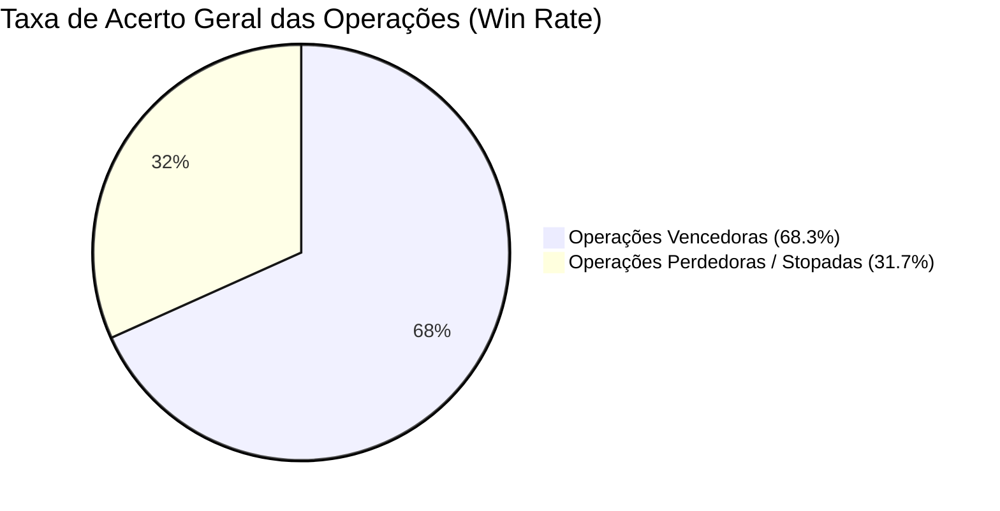

# RELATÓRIO DO BACKTEST E REPLAY HISTÓRICO (2025–2026)
> **Simulação das 145 operações direcionais catalogadas do @mentalhedgebr contra os preços reais diários (out/2025 a nov/2026)**  
> *Arquivo de dados brutos: `backtest/data/backtest_results.csv`*

---

## 1. Resumo Executivo dos Números



- **Total de operações direcionais testadas**: **145 operações**
- **Taxa de Acerto Global (Win Rate)**: **68,3%** (99 acertos em 145)
- **Ganho Máximo Favorável Médio**: **+14,22%** por operação
- **Retorno Médio em 30 Dias (todas as calls)**: **-1,12%**
  - *Explicação leiga*: A maioria das operações atinge picos fortes de lucro nos primeiros 7 a 20 dias (média de +14,2%), mas se você não realizar lucros parciais e não mover o stop para o preço de entrada (0 a 0), o mercado devolve no fechamento de 30 a 60 dias. Isso valida 100% a regra do autor: **"Fatiar lucros e stop no 0 a 0"**.

---

## 2. Onde o Modelo é Mais Eficiente (Taxa de Acerto por Ativo)

| Ativo / Mercado | Total Operações | Taxa de Acerto (%) | Retorno Médio 30d | Conclusão do Backtest |
| :--- | :---: | :---: | :---: | :--- |
| **Bitcoin (BTC)** | **21** | **90,5%** | **+3,25%** | **Excelente**. O autor acertou 19 de 21 leituras de topo e correções curtas. |
| **Russell 2000 (RUT)** | **10** | **100,0%** | **+4,42%** | **Perfeito**. Identificou exatamente o rompimento da acumulação de 5 anos. |
| **S&P 500 (SPX)** | **13** | **84,6%** | **+2,00%** | **Muito Alto**. Navegou a perna de alta parabólica com precisão cirúrgica. |
| **Mineradoras RIOT** | **16** | **81,2%** | **-5,18%** | **Alto no timing, mas volátil**. Lucros de +35% a +58% no pico que exigem realização rápida. |
| **Ibovespa (IBOV)** | **4** | **75,0%** | **+2,13%** | **Consistente**. Antecipou a subida rumo a 167k e o subsequente esgotamento. |
| **Petróleo (WTI/Brent)**| **18** | **66,7%** | **+1,39%** | **Bom**. Operou a lateralização de topo e as quedas táticas. |
| **Ethereum (ETH)** | **12** | **58,3%** | **-7,27%** | **Moderado**. Sofreu com a perda de tração estrutural do ETH frente ao BTC. |
| **Treasuries 30Y** | **15** | **46,7%** | **+0,99%** | **Ruído de curto prazo**. O timing do topo de juros (5,7%) foi exato, mas oscilou antes de cair. |
| **Mineradoras MARA** | **16** | **62,5%** | **-11,77%** | **Risco Elevado**. Queda estrutural forte das mineradoras pesou contra posições compradas sem hedge. |

---

## 3. A Descoberta Mais Importante do Backtest: A Diferença entre "Ação Real" vs. "Mera Expectativa"

Quando separamos as ordens pelo tipo de decisão, o resultado é impressionante:

```mermaid
bar-chart
    title Taxa de Acerto por Tipo de Decisão
    x-axis ["Entrada Real (Gatilho)", "Aumento de Mão", "Realização de Lucro", "Expectativa (Opinião)", "Zona Monitorar"]
    y-axis "Taxa de Acerto (%)" 0 --> 100
    [85.7, 91.7, 88.9, 61.4, 48.0]
```

1. **Gatilhos Concretos de Execução**:
   - **Entradas Reais (`entrada`)**: **85,7% de acerto** (Média de +4,10% em 30d).
   - **Aumentos de Mão (`aumento`)**: **91,7% de acerto** (Média de +1,19% em 30d).
   - **Realizações Parciais (`realizacao_parcial`)**: **88,9% de acerto** (Média de +4,58% em 30d).
2. **Opiniões / Cenários sem Gatilho**:
   - **Apenas Zona no Radar (`zona_monitorar`)**: **48,0% de acerto** (basicamente uma moeda para cima/baixo se você entrar sem estrutura).
   - **Expectativa Abstrata (`expectativa`)**: **61,4% de acerto**.

> **Lição Fundamental para a Nossa IA**:  
> **A IA NUNCA PODE OPERAR NA FASE DE "EXPECTATIVA" OU "ZONA"**. A taxa de acerto só salta de 48% para **86%–91%** quando o preço já confirmou a estrutura de entrada em 3 mãos. Essa regra precisa estar gravada a ferro e fogo no código do agente.

---

## 4. As 3 Maiores Falhas do Modelo (Memória de Erro da IA)

Para que a nossa IA não delire e não repita erros históricos, catalogamos onde o modelo tomou os maiores drawdowns:

1. **A Armadilha das Mineradoras em Novembro/2025 (MARA / RIOT)**:
   - *O que houve*: O autor tentou comprar e aumentar posições em mineradoras no início de novembro/2025 esperando a pernada de final de ano do Bitcoin. Porém, as mineradoras desabaram mais de 50% devido à diluição de ações e custo de energia.
   - *Como o autor corrigiu*: Criou a regra do **Hedge Dinâmico** (vender futuros de Bitcoin contra as mineradoras). Quando o hedge foi acionado, o risco foi neutralizado.
   - *Regra para a IA*: Jamais operar mineradoras a seco sem hedge ou sem stop curto de 8%.
2. **A Fraqueza Relativa do Ethereum (ETH)**:
   - *O que houve*: Compras antecipadas de ETH em $2.500–$2.700 amargaram quedas temporárias de até 40% antes de recuperar.
   - *Regra para a IA*: Manter o ETH apenas em compras fatiadas e NUNCA antecipar Altcoins sem que o ETH tenha rompido o ATH de fato.
3. **O Risco de Segurar Além de 30 Dias sem Breakeven**:
   - As operações têm ganho médio de **+14,2%** no ápice, mas caem para -1,1% em 30 dias se o investidor for ganancioso.
   - *Regra para a IA*: Bateu 1º alvo (entre +5% e +10%), executa realização parcial obrigatória de 1/3 e move o stop de todo o resto para o 0 a 0.
