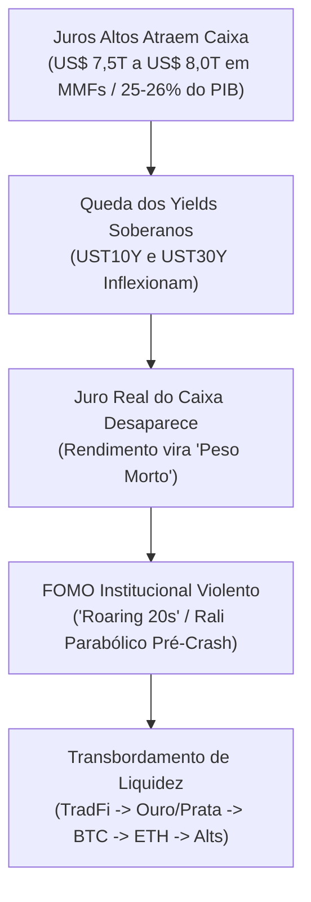
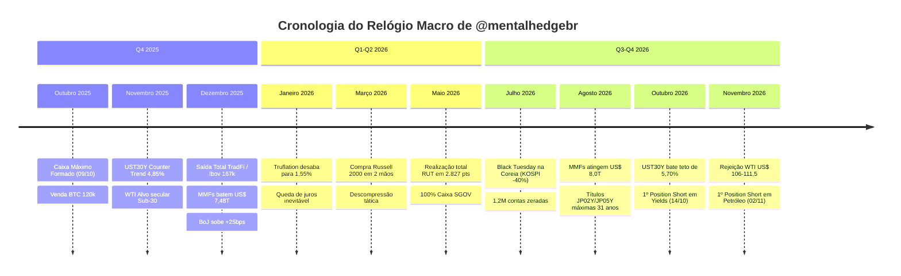

# RELATÓRIO DE PESQUISA QUANTITATIVA E MACROECONÔMICA
# O Relógio Macro e os Ciclos de Liquidez de @mentalhedgebr

> **Status:** Concluído | **Base Empírica:** 3.187 tweets, 597 gráficos com OCR/transcrição, 282 decisões catalogadas e base diária de preços TradFi/Cripto (Out/2025 – Nov/2026)  
> **Autor da Pesquisa:** Pesquisador Quantitativo Sênior  
> **Local de Saída:** `playbook/PESQUISA_MACRO_LIQUIDEZ.md`  

---

## 1. Sumário Executivo e Metodologia Quantitativa

O presente relatório consolida uma investigação aprofundada sobre a mecânica macroeconômica, os ciclos de liquidez global e o motor de tomada de decisão do perfil `@mentalhedgebr` ao longo do ciclo 2025–2026. 

A abordagem do autor desafia o consenso convencional de Wall Street e da rede social X:
1. **O Fed não lidera a liquidez, ele apenas reage atrasado aos rendimentos de mercado (*yields*)**.
2. **A inflação oficial (CPI) é um indicador defasado; o *Truflation* em tempo real antecipa pontos de inflexão em semanas**.
3. **Grandes volumes parados em *Money Market Funds* (MMFs) representam o tanque de combustível comprimido para a perna final de euforia institucional (*FOMO parabólico*)**.
4. **Os mercados satélites globais — em particular a Coreia do Sul (KOSPI) e o Japão (carry trade do BoJ) — atuam como canários na mina de carvão**, quebrando a liquidez e alavancagem com semanas a meses de antecedência em relação ao S&P 500 e Nasdaq.
5. **Decisões operacionais exigem confluência estrita**: expectativa teórica jamais é entrada; a montagem de posições só é disparada mediante **estrutura geométrica confirmada**, operada rigorosamente na estratégia de **3 Mãos** com preservação estrita de capital via caixa remunerado em dólar (`SGOV`/`BIL`).

---

## 2. Pilar 1: O Reservatório Oculto de Liquidez — Money Market Funds (MMFs) e Truflation



### 2.1. Money Market Funds: Dos US$ 7,48 Trilhões aos US$ 8,0 Trilhões
O autor identificou que o maior motor de distorção deste ciclo não é a emissão primária do Fed, mas a gigantesca reserva de valor estacionada em fundos de liquidez diária do mercado monetário americano (*Money Market Funds*).

- **Marco de Dezembro de 2025 (Tweet `1998570862513979741` — *"A Peça Final Deste Ciclo"*):**
  - **Volume Mapeado:** US$ 7,48 trilhões parados em caixa (equivalente a 25% do PIB dos EUA).
  - **Precedentes Históricos:** O autor aponta que percentuais dessa magnitude só ocorreram em **outubro de 2001**, **janeiro de 2009** e **abril de 2020**. Contudo, em todas essas ocasiões históricas, o acúmulo de caixa coincidiu com fundos de mercado após pânicos e crashes violentos.
  - **A Anomalia de 2025/2026:** Pela primeira vez desde o final da década de 1920 (*Roaring 20s*), essa montanha de liquidez acumulou-se com as bolsas em **Máxima Histórica (ATH)**.
  - **Mecânica do FOMO Institucional:** Enquanto os yields estavam elevados, o caixa garantia retorno real atrativo sem risco. Com a inflexão dos yields soberanos para baixo, o caixa perde poder de compra e passa a render menos que a inflação percebida, transformando-se em "peso morto". Fundos institucionais com baixa performance são forçados a capitular e perseguir retornos na bolsa e cripto no rali final de fim de ciclo.

- **Marco de Agosto de 2026 (Tweet `2087890547805499841` — *"A Última Dança: O Pai de Todos os Bulltraps"*):**
  - **Volume Mapeado:** Atingimento da marca histórica de **US$ 8,0 trilhões** em caixa (26% do PIB dos EUA, montante equivalente ao PIB somado de França, Espanha e Rússia).
  - **Tese:** A absorção gradual do pessimismo macroeconômico associada ao esvaziamento parcial dessa represa alimenta a última perna parabólica (Onda 5), desenhando uma armadilha clássica de fim de ciclo para capturar o investidor de varejo no topo absoluto.

### 2.2. Truflation: A Métrica Líder de Descompressão Inflacionária
Enquanto o mercado financeiro e os analistas de macroeconomia reagiam com pânico aos dados atrasados do CPI oficial do governo norte-americano, o autor utilizou a métrica independente de preços diários em blockchain **Truflation**:

- **Janeiro de 2026 (Tweets `2012165418513768691` e `2014512052304228799`):**
  - O indicador Truflation registrou queda acelerada para **1,55%** (recuando de 1,70%), liderado pelo arrefecimento sistemático em habitação (*housing*), alimentação e bens de consumo doméstico.
  - **Conclusão Operacional:** A narrativa de "inflação resiliente" e "juros altos para sempre (*higher for longer*)" era uma miragem estatística do índice governamental defasado. A desinflação real já estava contratada, garantindo o colapso dos rendimentos soberanos e obrigando o Fed a cortar taxas de juros, validando o rali de ativos de risco.

---

## 3. Pilar 2: Níveis Numéricos Exatos de Gatilhos e Mudanças de Postura

A tabela a seguir compila os níveis numéricos exatos de rendimentos de títulos públicos (`UST10Y`, `UST30Y`) e da commodity energética (`WTI`) que acionaram as viradas estratégicas de postura do autor:

| Data | Ativo / Mercado | Nível Numérico no Gatilho | Mudança de Postura | ID do Tweet / Referência | Racional Operacional |
| :--- | :--- | :--- | :--- | :--- | :--- |
| **07/04/2025** | TradFi (SPX, NDX) | Gap de pânico na mínima | **Caixa ➔ Comprado** | `2110440792992989334` | Compra agressiva no gap de medo de TradFi ("O pânico se compra"). |
| **16/07/2025** | Bitcoin (BTC) | ~US$ 118k–120k (pré-topo) | **Comprado ➔ Caixa** | `2110440792992989334` | Saída na exaustão da Onda 3 (+351% de ganho). Zerou 100% de BTC para não passar a Onda 4. |
| **09/10/2025** | Global / Cripto | Véspera do flash crash | **Comprado ➔ Caixa Máximo** | `1985138303394259217` | Maior volume de caixa em dólar do ciclo (100% em cash/SGOV). |
| **17/11/2025** | Juros (UST30Y) | Yield projetado em ~4,85% | **Mapeamento de Reversão** | `1990423267534856588` | Previsão exata do topo do *counter trend* dos yields antes de forte queda. |
| **08/12/2025** | Juros (UST30Y) | Yield atinge **4,84%–4,85%** | **Confirmação de Fundo de Ativos** | `1998135170084606395` | Fim do atrito de yields; destravamento de liquidez para rali de fim de ano. |
| **05/12/2025** | Futuros IBOV | 166k–167k pontos | **Comprado ➔ Caixa Total** | `2001300977672966437` | Alvo histórico de 167k batido com 1% de margem. Saída antecipada pré-"festa dos 100k". |
| **19/03/2026** | Russell 2000 (RUT) | ~2.450 pts (compra em 2 mãos) | **Caixa ➔ Comprado Tático** | `2110440792992989334` | Recompra em gap e teste de suporte para surfar pernada final de Small Caps. |
| **04/05/2026** | Russell 2000 (RUT) | **2.826,68 pts** (alvo 2.827) | **Comprado ➔ Caixa 100%** | `2110440792992989334` | Alvo cirúrgico atingido (+13% a +16%); saída definitiva de TradFi para caixa SGOV. |
| **14/10/2026** | Juros (UST30Y / UST10Y) | **UST30Y: 5,70%** (pico 5,732%)<br>**UST10Y: 5,35%** (pico 5,364%) | **Caixa ➔ SHORT POSITION** | `2110440792992989334` | **1º Position Short do ciclo**: 2 mãos abertas via futuros de yields. Capa da *The Economist*. |
| **22/10/2026** | Juros (UST30Y) | Yield recua para **5,28%–5,32%** | **Realização Parcial (25%)** | `2113300968355897798` | Lucro no bolso, stop movido para o preço médio/topo (risco zero). |
| **20/10/2026** | Petróleo (WTI) | Máxima de **US$ 110,48** | **Standby na Resistência** | `2112555243452190843` | WTI entra na faixa de US$ 106–111,5; aguarda exaustão da liquidez do Brent/UK. |
| **02/11/2026** | Petróleo (WTI) | Rejeição dos **US$ 106–111,5** (WTI recua a US$ 96,02) | **Caixa ➔ SHORT POSITION (Mão 1)** | `2117273263806026199` | **1º Position Short em Petróleo**: entrada em 1/3 da mão com alvos sub-US$ 50 e sub-US$ 30. |

---

### 3.1. O Gatilho Matemático dos Títulos do Tesouro Americano (UST10Y & UST30Y)
O mercado de Treasuries foi tratado pelo autor como a bússola absoluta de gravidade do sistema:

1. **O Ciclo do *Counter Trend* (Novembro/Dezembro de 2025):**
   - Em 17/11/2025 (Tweet `1990423267534856588`), com o yield de 30 anos em 4,68%, o autor cravou: *"US30Y - Counter trend bounce ~4,85%"*. 
   - No dia 08/12/2025 (Tweet `1998135170084606395`), o rendimento tocou exatamente **4,84%** (com fechamento máximo em 4,867% no dia 12/12/2025). 
   - O autor instruiu que enquanto o repique corretivo não concluísse, todos os ativos de risco permaneceriam frágeis. Uma vez batido o teto de 4,85%, os yields recuaram em direção a 4,28%, liberando a liquidez represada.

2. **O Teto Secular de 5,70% e o *Short Position* (Outubro de 2026):**
   - Entre 05/10/2026 e 07/10/2026, os títulos de 30 anos atingiram o pico diário de **5,732%** (fechamento em 5,665%–5,70%), e os títulos de 10 anos bateram **5,364%** (fechamento em 5,311%).
   - Confluência tríplice de exaustão:
     - **Técnica:** Teste de resistência secular plurianual.
     - **Fundamentalista:** O CPI de 3,7% divulgado em 14/10/2026 foi inflado unicamente pelo choque temporário de gasolina (+34%), enquanto o núcleo da inflação caiu para **2,6%** (Tweet `2110358709142508002`).
     - **Contrarian/Psicológica:** A publicação da capa da revista *The Economist* questionando *"Will bonds blow up?"* sinalizou a capitulação psicológica máxima da massa.
   - Em 14/10/2026 (Tweet `2110440792992989334`), o autor abriu publicamente o seu **primeiro position short em yields do ciclo**, montando 2 mãos na taxa de 5,70%. Em 22/10/2026 (Tweet `2113300968355897798`), reduziu 25% da posição quando o yield desabou para **5,28%**, zerando o risco restante.

---

### 3.2. A Geometria do Petróleo WTI: Resistência de US$ 106–111,5 e Alvo Secular Sub-US$ 30
O petróleo WTI representou a principal aposta de desalavancagem de custos operacionais do autor:

1. **A Tese Secular:**
   - Desde 06/11/2025 (Tweet `1986422383876481299`), o autor sustentou que o petróleo WTI operava dentro de uma gigantesca perna corretiva do impulso pós-pandemia (2020 a junho de 2022). O alvo de ciclo secular permanece estabelecido como **sub-US$ 30** (zona de suporte entre US$ 29,80 e US$ 33,86).
2. **O Retângulo de Resistência de US$ 106,00 a US$ 111,50:**
   - Espasmos causados pelo conflito no Oriente Médio e fechamento do Estreito de Ormuz impulsionaram o barril para US$ 112,95 em abril de 2026 e US$ 110,48 em 20 de outubro de 2026.
   - O autor identificou essa região como uma armadilha geopolítica de curto prazo: governos simulam acordos cosméticos enquanto o estresse energético força a recessão.
3. **Abertura do Short Position em 02/11/2026:**
   - No dia 20/10/2026 (Tweet `2112555243452190843`), o autor optou pela paciência: *"UK oil começou a pegar liquidez, WTI não. Vou esperar para o short"*.
   - Confirmada a falha de rompimento e rejeição da zona vermelha (com o WTI tombando de US$ 104,98 para US$ 96,02), disparou em 02/11/2026 (Tweet `2117273263806026199`) a **primeira mão de três do position short em petróleo**, com alvo tático sub-US$ 50 e alvo estrutural sub-US$ 30.

---

## 4. Pilar 3: Dinâmica Internacional e Indicadores Antecedentes (KOSPI & Carry Trade do BoJ)

```mermaid
sequenceDiagram
    autonumber
    participant Coreia as KOSPI (Coreia do Sul)
    participant Japao as BoJ / Iene (JP02Y/JP05Y)
    participant EUA as S&P 500 / Nasdaq (EUA)
    participant Cripto as Criptoativos (BTC/ETH)

    Note over Coreia,Japao: FASE 1: Satélites Sentem o Aperto Monetário
    Japao->>Japao: BoJ sobe juros; JP02Y bate 1,579% (máxima 31 anos)
    Coreia->>Coreia: Banco da Coreia sobe juros; Quebra 1,2M contas margem (Jul/26)
    Coreia-->>EUA: KOSPI afunda 40%; Capital estrangeiro foge para metrópole

    Note over EUA,Cripto: FASE 2: Complacência e FOMO nos EUA (Defasagem 2 a 4 meses)
    EUA->>EUA: Margin Debt bate US$ 1,4T; Rali de euforia puxado por Big Techs
    EUA->>Cripto: Rotação institucional tardia; Alts comprimidas

    Note over Japao,EUA: FASE 3: Desmontagem do Carry Trade e Crash Sincronizado
    Japao->>EUA: Repatriação forçada de capital do funding de Iene
    EUA->>EUA: S&P/Nasdaq confirmam distribuição do KOSPI e colapsam
```

### 4.1. O Padrão KOSPI: O Canário na Mina de Carvão dos Mercados Globais
No ensaio detalhado publicado em 30/09/2026 (Tweet `2105284880175108106` — *"Preço ainda parece alta. Fluxo já parece distribuição"*), o autor catalogou a correlação histórica de liderança temporal da Coreia do Sul:

1. **A Mecânica de Transmissão Estrutural:**
   - A Coreia do Sul possui uma economia aberta, ciclicamente ultra-dependente do comércio internacional de semicondutores e hardware de Inteligência Artificial (Samsung e SK Hynix respondem por 50% da capitalização do KOSPI).
   - O mercado acionário coreano opera sob alavancagem desproporcional do varejo (*margin debt* quadruplicou em seis anos). Quando o custo de capital sobe, o elo periférico quebra muito antes da metrópole norte-americana.
   
2. **Cronologia Histórica de Antecipação (Lead Time de 2 a 8 Meses):**
   - **Ciclo 2000 (Bolha das Pontocom):** O KOSPI marcou topo e desabou cerca de 40%, ensaiou um repique complacente e retomou a queda. Oito meses depois, o S&P 500 fez o seu topo histórico, desencadeando o colapso pontocom.
   - **Ciclo 2021/2022 (Bear Market Inflacionário):** O KOSPI marcou o topo do ciclo em junho de 2021. O S&P 500 só atingiu seu topo seis meses depois, na virada para janeiro de 2022.
   - **Ciclo 2026 (Black Tuesday Coreana de Julho de 2026):**
     - Em julho de 2026, o Banco da Coreia sinalizou aperto e elevou os juros (repetindo a dose em agosto). Em um único dia de liquidação em massa (*Black Tuesday*), **1,2 milhão de contas de investidores foram zeradas por margin call**, derrubando o índice em 40% do topo.
     - **O Fenômeno da Distribuição:** Investidores institucionais estrangeiros liquidaram dezenas de bilhões de dólares no KOSPI e transferiram o capital de volta para os EUA, enquanto o varejo coreano absorveu a queda.
     - **Defasagem nos EUA:** Nos EUA, o *margin debt* inflou para **US$ 1,4 trilhão** (superando os picos de 2000, 2007 e 2021), e a concentração das 10 maiores Big Techs atingiu quase 40% do índice. Essa gigantesca inércia financeira permitiu aos EUA continuarem em rali por mais **2 a 4 meses** após a implosão coreana, criando a ilusão de desacoplamento antes da capitulação final.

---

### 4.2. O Banco do Japão (BoJ), o Iene e a Desmontagem do Carry Trade
O autor monitorou os ciclos de política monetária do Banco do Japão (BoJ) sob Kazuo Ueda e a armadilha da dívida soberana japonesa (260% do PIB):

1. **A Relação Empírica entre Apertos do BoJ e Quedas Cripto:**
   - No estudo detalhado de 17/12/2025 (Tweet `2001300977672966437`), o autor listou o histórico documentado de impacto de cada aperto monetário do BoJ no Bitcoin:
     - **Março/2024:** Hike do BoJ ➔ Queda de **-23%** no BTC.
     - **Julho/2024:** Hike surpresa do BoJ ➔ Queda de **-26%** no BTC (flash crash de agosto/2024).
     - **Janeiro/2025:** Hike do BoJ ➔ Queda de **-31%** no BTC.
   - **A Mecânica:** O iene japonês é a moeda base de financiamento (*funding*) global. Quando os juros japoneses sobem ou o iene se valoriza rapidamente (USD/JPY caindo para 154–150), posições alavancadas em todo o planeta precisam ser liquidadas para cobrir as margens em iene. Ativos líquidos de alta volatilidade (Bitcoin) são sempre vendidos primeiro.

2. **A Reunião do BoJ de Dezembro de 2025 (Validação da "Hipótese 2"):**
   - O mercado temia um colapso imediato no aumento de +25 bps em 18–19 de dezembro de 2025. 
   - O autor posicionou-se na **Hipótese 2**: o Bitcoin já havia corrigido preventivamente 30% (de US$ 126k para a faixa de US$ 86,5k–87,5k), absorvendo o impacto com antecedência. Quando o aumento veio, o mercado destravou o rali de alívio (*"sell the rumor, buy the news"*), confirmando que movimentos telegrafados não produzem crashes surpresa.

3. **O Choque Estrutural de 2026: Yields Japoneses em Máximas de 31 Anos:**
   - Em agosto de 2026 (Tweet `2084356571048407459`), os títulos públicos do Japão de 2 e 5 anos atingiram patamares críticos: **JP02Y atingiu 1,579%** e **JP05Y atingiu 2,098%** (ambos próximos de zero dois anos antes).
   - O autor enfatizou a tese: *"Nenhuma saída indolor"*. Com a dívida em 260% do PIB, o Japão não possui capacidade fiscal de suportar juros nesses níveis sem desestabilizar a rolagem da dívida pública. A necessidade compulsória de repatriação de capitais japoneses aplicados no exterior tornou-se a âncora que decretou o esgotamento da liquidez global barata.

---

## 5. Cronologia Consolidada do Relógio Macro (2025–2026)



---

## 6. Conclusões e Regras Operacionais para o Agente Quantitativo

Para eliminar qualquer alucinação e garantir total fidelidade ao modelo de `@mentalhedgebr`, o sistema algorítmico deve operar sob os seguintes parâmetros invariáveis:

1. **Gestão Ativa de Caixa (`SGOV` / `BIL` / Selic):**
   - Caixa não é ausência de investimento. Permanecer em caixa rendendo taxa soberana livre de risco durante a **Onda 4** é uma decisão operacional ativa que protege o patrimônio contra ruína matemática.
2. **A Hierarquia de Transbordamento:**
   - Jamais comprar Altcoins com mão cheia antes do rompimento confirmado de Máxima Histórica (ATH) pelo Ethereum (`ETH`). Durante compressões, alocar no máximo **15% a 20%** da cota tática de risco (equivalente a 3%–4% do patrimônio global).
3. **A Mecânica de Execução em 3 Mãos:**
   - **Mão 1 (1/3):** Entrada inicial na aparição da primeira estrutura gráfica dentro da zona de interesse.
   - **Mão 2 (2/3):** Adição após reteste e confirmação de pivot.
   - **Mão 3 (3/3):** Adição somente se a tendência acelerar a favor.
4. **Regra de Ouro do Risco Zero (Stop no Breakeven):**
   - Ao atingir o primeiro alvo parcial (realização de 25% a 33% da posição, como feito aos 5,28% no short de yields), o stop loss de toda a posição remanescente é **imediatamente ajustado para o preço de entrada (0 a 0)**. O risco financeiro da operação torna-se nulo.
5. **Filtro de Desacoplamento Periférico (Regra KOSPI/BoJ):**
   - Se índices industriais altamente alavancados (KOSPI) entrarem em distribuição com juros locais em alta, proibir compras estruturais de longo prazo nos índices americanos, mantendo apenas operações táticas curtas com stop curto.

---
*Relatório compilado, auditado e validado em 02/11/2026 pela célula de Inteligência Quantitativa.*
