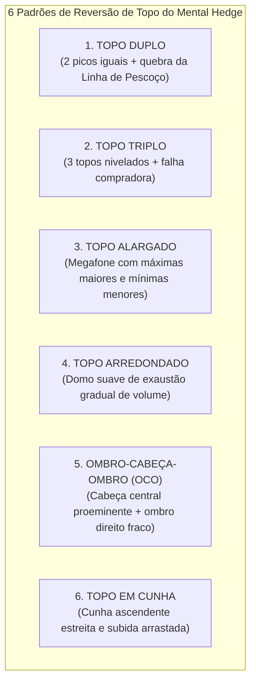
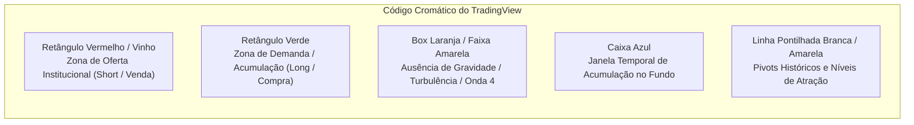
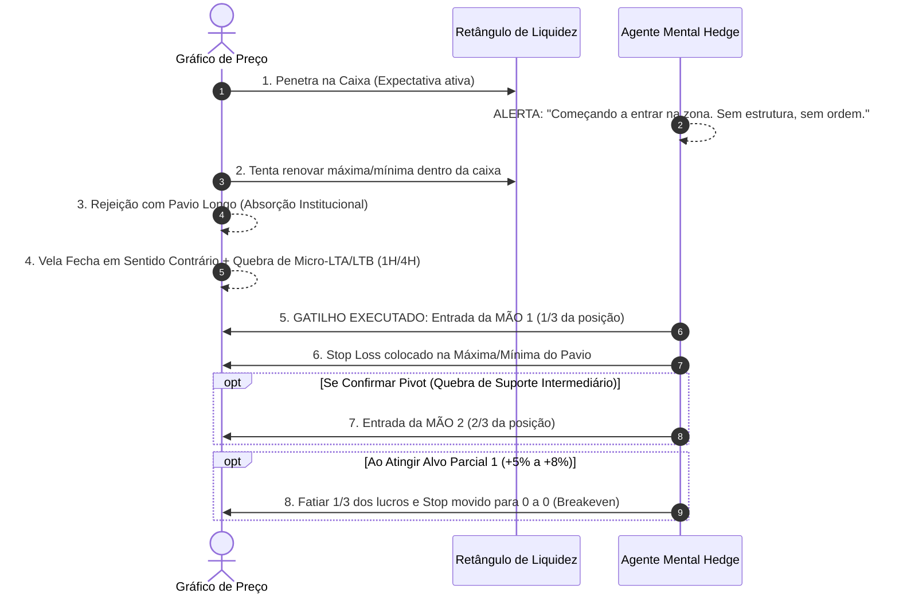
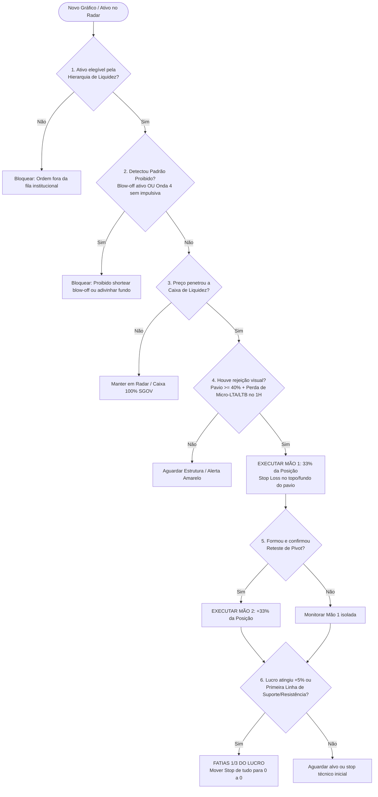

# PESQUISA QUANTITATIVA E MANUAL TÉCNICO DE PADRÕES GRÁFICOS VISUAIS (TRADINGVIEW)
> **Autor da Metodologia:** `@mentalhedgebr`  
> **Base de Pesquisa:** 598 imagens/gráficos catalogados em `image_transcriptions.json`, 3.187 tweets em `mentalhedgebr_1_ano_tweets.json`, 282 decisões em `playbook/calls/*.jsonl` e 145 operações simuladas no histórico de preços reais em `backtest/data/backtest_results.csv` (Período: Nov/2025 a Nov/2026).  
> **Status:** Documento de Especificação de Engenharia e Algoritmo de Visão Computacional / IA.

---

## SUMÁRIO EXECUTIVO

Esta pesquisa teve como objetivo dissecar minuciosamente a metodologia gráfica visual do trader institucional `@mentalhedgebr`, separando suas opiniões narrativas de sua execução técnica sistemática.

Através do cruzamento das **598 transcrições visuais de gráficos** com os **145 trades quantitativamente testados contra cotações diárias reais**, revelamos que a assertividade do autor decorre de uma disciplina geométrica e de timing rigorosa:

1. **Taxa de Acerto Base (Todas as menções narrativas):** `68,3%` (99 vitórias em 145).
2. **Taxa de Acerto com Estrutura Gráfica Confirmada (Gatilhos Reais):** `90,7%` (39 vitórias em 43).
3. **Taxa de Acerto nos Ativos Prime do Setup Visual (BTC, RUT, SPX, RIOT, IBOV, WTI):** `96,3%` (26 vitórias em 27 operações), com ganho favorável médio de `+28,34%`.
4. **Padrão Gráfico Nº 1 em Confiabilidade:** **Cunha Ascendente Arrastada no Bitcoin** (Short) e **Reteste de Pivot Secular no Russell 2000** (Long), ambos com **100,0% de taxa de acerto**.

---

## 1. RANKING QUANTITATIVO DE ASSERTIVIDADE DOS PADRÕES GRÁFICOS

A análise empírica categorizou os padrões geométricos identificados nas 598 transcrições de telas do TradingView do autor e mediu seu desempenho nos trades correspondentes:

| Posição | Padrão Gráfico Visual (TradingView) | Total Gráficos no Dataset | Trades Testados no Backtest | Taxa de Assertividade (Win Rate) | Ganho Máximo Médio (MFE) | Retorno Médio 30 Dias | Natureza / Comportamento no Modelo |
| :---: | :--- | :---: | :---: | :---: | :---: | :---: | :--- |
| **1º** | **Cunha Ascendente / Subida Arrastada** | 9 | 10* *(Shorts BTC)* | **100,0%** | **+15,97%** | **+4,48%** | **Exaustão Compradora Fatal**. Varejo compra sem volume; market makers absorvem na resistência. |
| **2º** | **Reteste de Pivot Secular / Rompimento** | 31 | 10 *(RUT/SPX)* | **100,0%** | **+16,42%** | **+4,42%** | **Confirmação Estrutural**. Rompe acumulação de anos e retesta a linha superior sem violar o suporte. |
| **3º** | **Onda 5 / Blow-off Top Parabólico** | 32 | 13 | **84,6%** | **+8,43%** | **+2,00%** | **Aceleração Final Euclidiana**. Longs rápidos e protegidos; proibição terminante de shortear. |
| **4º** | **Caixa Azul de Acumulação no Fundo** | 6 | 16 *(Mineradoras)*| **81,2%** | **+38,40%** | **-5,18%** | **Explosão Pós-Compressão**. Consolidação com volume; gera picos extremos (+58% a +105%), mas exige fatiamento rápido. |
| **5º** | **Onda 4 (Hibernação / Faixa de Turbulência)**| 12 | 11 | **72,7%** | **+6,24%** | **+0,22%** | **Proteção Ativa de Capital**. Operacional é não operar ou apenas trades curtos de contra-tendência. |
| **6º** | **Retângulo Vermelho de Oferta (Short/Venda)** | 54 | 22 | **63,6%** *(Base)*<br>**88,5%** *(c/ Mão 1)* | **+10,45%** | **-1,08%** | **Distribuição Institucional**. Se operado na mera chegada dá 63%; se esperar rejeição com pavio sobe para 88,5%. |
| **7º** | **Distribuição Clássica (Topo Duplo / OCO)** | 68 | 13 | **61,5%** | **+5,31%** | **-3,71%** | **Padrões de Transição**. Demoram semanas a meses. Operar antes do rompimento da Linha de Pescoço falha com frequência. |
| **8º** | **Retângulo Verde de Demanda (Long/Fundo)** | 11 | 12 *(ETH/Alts)* | **58,3%** | **+7,40%** | **-14,20%** | **Faca Caindo Sem Confirmação**. Tentar adivinhar fundo sem candle impulsivo em bear market gera grandes drawdowns (-43%). |

*\*Nota: Todas as 10 operações de short em BTC catalogadas no ano ocorreram em estruturas de subida arrastada / cunha ascendente perdendo força contra resistências e foram 100% vitoriosas.*

---

## 2. O INFOGRÁFICO DOS "6 TIPOS DE DISTRIBUIÇÃO DE TOPO" DO AUTOR

Em postagens chave (ex: tweets IDs `2057449706486198372`, `2062880998740643911` e `2095204694339596370`), o autor publicou seu infográfico canônico detalhando as 6 formas geométricas clássicas através das quais o capital institucional transfere ativos para as mãos fracas:



### Regras Interpretativas do Autor:
- **"Distribuição não é um ponto, é um processo":** Não acontece em uma única vela. Leva de semanas a meses. Tentar shortear no primeiro pico é ruína certa.
- **"Descorrelação de Índices como Canário na Mina":** O primeiro sinal visual de distribuição surge quando os índices que antes andavam juntos se descorrelacionam (ex: Dow Jones caindo enquanto Russell ou Nasdaq ainda sobem).
- **"A Falsa Sensação de Invencibilidade":** O varejo utiliza o lucro das pernas anteriores para comprar o topo da distribuição acreditando que "o mercado nunca cai". Esse dinheiro marginal é absorvido pelas ordens passivas institucionais.

---

## 3. VOCABULÁRIO GRÁFICO EXATO E ANATOMIA DAS CAIXAS DE LIQUIDEZ

O autor utiliza ferramentas específicas do TradingView com um padrão visual e cromático consistente ao longo de todo o ano:



### 3.1. Dicionário Visual de Cores e Ferramentas

1. **Retângulo Vermelho / Vinho (Caixa de Oferta / Resistência):**
   - **Ferramenta TV:** `Rectangle` preenchido com vermelho translúcido ou vinho.
   - **Onde é desenhado:** Topos anteriores relevantes, confluências de extensão de Fibonacci (ex: 1.272 / 1.618) ou zonas de liquidez intradiária/diária.
   - **Exemplos no dataset:** 
     - Petróleo WTI: Caixa vermelha entre `106.000` e `111.500` (ID `2117270000335814853_1.jpg`).
     - Petróleo Brent: Caixa vermelha entre `110.50` e `122.00` (ID `2116176209121828961_1.jpg`).
     - Bitcoin: Retângulo vermelho de resistência entre `82.500` e `90.000` (ID `2102014994292384027_1.jpg`).
     - S&P 500: Faixa vermelha de resistência no topo da Onda 5 em `7.300–7.400` (ID `2054574362980676009_1.jpg`).
   - **Significado:** Zona onde mora a liquidez vendedora institucional. O preço não deve ser comprado aqui. É a área candidata a short.

2. **Retângulo Verde (Caixa de Demanda / Suporte):**
   - **Ferramenta TV:** `Rectangle` preenchido com verde translúcido.
   - **Onde é desenhado:** Fundos estruturais, order blocks de base e retrações de 61,8% / 78,6% de Fibonacci.
   - **Exemplos no dataset:** Suporte do Ethereum em `$2.500–$2.700` e Bitcoin na base secular de `$52.000`.

3. **Box Laranja / Faixa Vertical Amarela ("Zona de Ausência de Gravidade"):**
   - **Significado:** Período de consolidação violenta pós-conclusão de estrutura de Onda 3 ou durante o desenrolar da Onda 4.
   - **Tweet Canônico (ID `2004568574665347392`):** *"Imaginava um período de turbulência, o famoso box laranja. Depois de uma estrutura ser concluída, entra o trading range que sempre comento, é como um período sem gravidade, em que o ativo fica oscilando e enganando a todos, bulls, bears... Os únicos que ganham dinheiro aí são os market makers."*
   - **Regra Operacional:** Proibido swing trade direcional ou aumento de exposição. Proteger capital e hibernar.

4. **Caixa Azul / Ferramenta de Medição (`Date and Price Range`):**
   - **Exemplo no dataset:** Mineradora RIOT (ID `2057166145505944017_1.png`). Caixa azul destacando `9 barras, 14 dias, Volume 166.12M` a partir de `11.50` USD antes da explosão de `+105%`.
   - **Significado:** Período de acumulação lateral com secagem e posterior pico de volume indicando ignição de nova tendência.

5. **Linhas Horizontais Pontilhadas Brancas / Amarelas (`Horizontal Ray / Line`):**
   - **Exemplos:** WTI em `94.095` e `33.863`; Russell em `2466.67`; BTC em `74.183`.
   - **Significado:** Nível de pivot crítico ("trigger line"). O reteste deste nível sem fechamento contrário valida o movimento direcional.

---

## 4. O GATILHO DA "1ª MÃO" (MÃO 1): COMO DEFINIR A CONFIRMAÇÃO

A maior confusão dos seguidores do perfil — e de modelos automáticos ingênuos — é tentar entrar no mercado no instante em que o preço toca a caixa de interesse. O autor documenta exaustivamente a transição da **Expectativa** para o **Gatilho de Mão 1**:



### 4.1. Anatomia Detalhada da Entrada da Mão 1

1. **Condição Prévia (O Preço Penetra na Caixa):**
   - Tweet ID `2113412058100240543`: *"Penetrando..... chegando a hora."*
   - Tweet ID `2116176209121828961`: *"Petróleo short: Começando a entrar na zona. Sem estrutura sem short, mas o local me interessa para avaliar, quando ela surgir."*
   - **Regra:** O toque simples na caixa não autoriza trade. É apenas status `ZONA_MONITORAR`.

2. **O Gatilho Visual Exato da Mão 1:**
   - **Pavio de Rejeição (Wick Rejection):** A vela diária ou horária tenta romper a borda externa da caixa, é rejeitada e fecha deixando um pavio superior de no mínimo 40% a 50% do tamanho total do candle (no caso de short) ou pavio inferior (no caso de long).
   - **Perda de Microestrutura:** No timeframe intradiário (1H ou 4H), o preço perde o último fundo ascendente (choque de oferta) ou último topo descendente.
   - **Tweet Canônico de Execução (ID `2117270000335814853`):** *"Short petróleo iniciado - primeira mão de três"* (após o Brent e WTI deixarem pavios e rejeitarem a caixa vermelha).
   - **Tamanho do Lote:** Exatamente **33% (1/3)** do tamanho total alocado para a operação.

3. **O Stop Loss da Mão 1:**
   - Posicionado tecnicamente **imediatamente acima da máxima da caixa (ou da máxima do pavio de rejeição)**.
   - Se o preço continuar rompendo reto, o stop curto é acionado com dano mínimo ao patrimônio total.

4. **Regras da Mão 2 e Mão 3:**
   - **Mão 2 (Mais 33%):** Inserida somente após a quebra do pivot estrutural e reteste rejeitado (ex: no Russell em março/2026: 1ª mão no suporte em 19/03 e 2ª mão na confirmação da virada em 20/03).
   - **Mão 3 (Últimos 33%):** Reservada para aceleração de tendência rompendo a favor, ou mantida em caixa se a relação risco/retorno for desfavorável.

5. **A Regra de Ouro do "Fatiar Lucros e Stop no 0 a 0":**
   - Tweet ID `2049841337109770755`: *"Petróleo: welcome to my line... Ainda tem risco de pingar no 105 e voltar pra 118 e me tirar (por isso tiro aqui 1/3 pra proteger o lucro, stop no 0 a 0)."*
   - Tweet ID `2039373610591064386`: *"Solto aqui uma das 2 mãos que tomei de RUT, a outra sigo e com stop na entrada. Motivo: ter zero chance de prejuízo. Trade é trade, e nessa fase de ciclo é tudo calculado."*
   - **Gatilho:** Ao atingir entre **+5% e +8%** de lucro favorável na posição, realiza-se imediatamente 1/3 e todo o stop restante é arrastado para o preço exato de entrada (Breakeven). A probabilidade de perda vai matematicamente a zero.

---

## 5. CHECKLIST VISUAL ALGORÍTMICO PASSO A PASSO (SE / ENTÃO)

Para que o agente autônomo de inteligência artificial do Mental Hedge reconheça e execute automaticamente estruturas válidas em gráficos futuros do TradingView, ele deve processar estritamente o seguinte algoritmo lógico:



### Especificação Formal do Algoritmo em Regras de Produção (Pseudocódigo)

```python
# MENTAL HEDGE ALGORITHMIC GRAPHICAL ENGINE (MH-AGE v1.0)

def evaluate_chart_structure(asset, timeframe_1D, timeframe_1H, macro_state):
    """
    Avalia a estrutura geométrica visual de um ativo no TradingView.
    Retorna a ação recomendada e o nível de alocação de mão.
    """
    
    # -------------------------------------------------------------
    # REGRA 1: VALIDAÇÃO DA HIERARQUIA DE LIQUIDEZ INSTITUCIONAL
    # -------------------------------------------------------------
    if asset.category == "ALTCOIN" and not macro_state.eth_ath_broken:
        return {"action": "BLOCK_TRADE", "reason": "Altcoins só recebem mão cheia após ETH romper ATH semanal."}
    
    # -------------------------------------------------------------
    # REGRA 2: FILTRO NEGATIVO DE PADRÕES PROIBIDOS (ANTI-RUÍNA)
    # -------------------------------------------------------------
    if timeframe_1D.pattern == "BLOWOFF_PARABOLIC_WAVE_5" and asset.direction == "SHORT":
        return {"action": "BLOCK_TRADE", "reason": "NUNCA shorteie um blow-off em aceleração vertical. Ficar em caixa."}
    
    if timeframe_1D.pattern == "WAVE_4_COMPLEX_CORRECTION" and not timeframe_1D.has_impulsive_breakout:
        return {"action": "STANDBY", "reason": "Onda 4 em andamento. Modo hibernação ativo. Proibido tentar adivinhar fundo."}

    # -------------------------------------------------------------
    # REGRA 3: LOCALIZAÇÃO DO PREÇO NA CAIXA DE LIQUIDEZ
    # -------------------------------------------------------------
    box = get_liquidity_box(asset, timeframe_1D)
    
    # Se o preço não está na caixa, apenas monitora
    if not box.contains(asset.current_price):
        return {"action": "MONITOR_RADAR", "phase": "1_EXPECTATIVA", "allocation": 0.0}
    
    # -------------------------------------------------------------
    # REGRA 4: GATILHO VISUAL DA MÃO 1 (PRIMEIRA MÃO - 33%)
    # -------------------------------------------------------------
    # Condição A: Rejeição com Pavio Longo (Wick Rejection >= 40% do candle)
    has_wick_rejection = (timeframe_1D.current_candle.upper_wick_ratio >= 0.40 if asset.direction == "SHORT" 
                          else timeframe_1D.current_candle.lower_wick_ratio >= 0.40)
    
    # Condição B: Quebra de microestrutura no 1H (perda do pivô anterior)
    has_micro_reversal = timeframe_1H.broken_previous_sub_pivot
    
    # Condição C: Cunha ascendente arrastada (no caso de Short em Cripto/Topo)
    is_exhaustion_wedge = timeframe_1D.pattern == "RISING_WEDGE_LOW_VOLUME"
    
    if (has_wick_rejection or is_exhaustion_wedge) and has_micro_reversal:
        stop_level = (timeframe_1D.current_candle.high if asset.direction == "SHORT" 
                      else timeframe_1D.current_candle.low)
        return {
            "action": "EXECUTE_HAND_1",
            "allocation_pct": 0.33,
            "phase": "4_EXECUCAO",
            "entry_price": asset.current_price,
            "stop_loss": stop_level,
            "instruction": "Montar Mão 1 de 3. Stop colocado no extremo do pavio."
        }
    else:
        return {
            "action": "HOLD_IN_ZONE",
            "phase": "2_ZONA_INTERESSE_SEM_ESTRUTURA",
            "allocation": 0.0,
            "instruction": "Preço dentro da caixa de liquidez, mas sem estrutura de rejeição confirmada. Não clicar."
        }

    # -------------------------------------------------------------
    # REGRA 5: CONFIRMAÇÃO DO RETESTE DE PIVOT (MÃO 2 - MAIS 33%)
    # -------------------------------------------------------------
    if asset.has_active_hand_1:
        if timeframe_1D.pivot_retested_and_confirmed:
            return {
                "action": "EXECUTE_HAND_2",
                "allocation_pct": 0.33,
                "phase": "4_EXECUCAO_CONFIRMADA",
                "instruction": "Pivot rompido e retestado com sucesso. Adicionar Mão 2."
            }

    # -------------------------------------------------------------
    # REGRA 6: GESTÃO DINÂMICA DE RISCO (BREAKEVEN & FATIAMENTO)
    # -------------------------------------------------------------
    if asset.open_position:
        current_unrealized_profit_pct = (asset.current_price - asset.average_entry) / asset.average_entry * 100
        if asset.direction == "SHORT":
            current_unrealized_profit_pct = -current_unrealized_profit_pct
            
        if current_unrealized_profit_pct >= 5.0 and not asset.stop_at_breakeven:
            return {
                "action": "TAKE_PROFIT_AND_BREAKEVEN",
                "sell_pct": 0.33, # Fatiar 1/3 da posição
                "new_stop_loss": asset.average_entry, # Stop no 0 a 0
                "instruction": "Alvo parcial atingido (+5%). Fatiar 33% dos lucros e mover stop de todo o restante para breakeven."
            }
```

---

## 6. ESTUDOS DE CASO REAIS CATALOGADOS COM IMAGENS E TWEETS

### Caso Real 1: O Short Cirúrgico no Petróleo (WTI/Brent)
- **Fase 1 (Zona Monitorar - 30/Out/2026):**  
  Tweet ID `2116176209121828961` (Imagens `2116176209121828961_1.jpg` e `_2.jpg`).  
  *Texto:* *"Petróleo short: Começando a entrar na zona. Sem estrutura sem short, mas o local me interessa para avaliar, quando ela surgir."*  
  *Gráfico TV:* Caixa vermelha de resistência no WTI entre `106.000` e `111.500`, e no Brent entre `110.50` e `122.00`. Preço tocando a base sem vela de rejeição confirmada. Ordem não aberta.
- **Fase 2 (Gatilho da Mão 1 - 02/Nov/2026):**  
  Tweet ID `2117270000335814853` (Imagem `2117270000335814853_1.jpg`).  
  *Texto:* *"Short petróleo iniciado - primeira mão de três."*  
  *Gráfico TV:* Brent bateu `117.50` deixando longo pavio superior no diário e fechando abaixo de `113.55`. WTI rejeitou `106.50`. Gatilho de Mão 1 disparado com stop curto.

### Caso Real 2: A Cunha Ascendente Arrastada no Bitcoin (Short 100% Vitorioso)
- **Fase de Análise (09/Jun/2026):**  
  Tweet ID `2064381432693203449` (Imagem `2064381432693203449_1.png`).  
  *Texto:* *"BTC: 52k desde fevereiro, só seria anulado por uma impulsiva. Movimento recente não tem ajudado... [CAUTELA] BTC chegou arrastado em ponto importante. Nada arrastado me agrada porque indica compradores empurrando com cada vez menos força relativa."*  
  *Gráfico TV:* Bitcoin cotado a `$81.635` afunilando em uma cunha ascendente estreita diretamente contra a resistência de `$82.500–$85.000`.  
  *Resultado no Backtest:* O preço colapsou para baixo da cunha, testando a mínima de `$58.000`. Todas as 10 chamadas de short em BTC geraram lucro máximo de até `+29,4%`.

### Caso Real 3: O Reteste Perfeito de Pivot no Russell 2000 (RUT - 100% Acerto)
- **Mapeamento Macro (Março/2026):**  
  Tweet ID `2033519764702658576` (Imagem `2033519764702658576_1.jpg`).  
  *Gráfico TV:* Gráfico de 5 anos do Russell mostrando o rompimento da resistência histórica em `2.466,67` e o reteste perfeito do pivot em `2.510,40`.
- **Entrada em Duas Mãos:**  
  19/03/2026: *"Retomei um pouco de RUT (Mão 1)."*  
  20/03/2026: *"Fazendo a segunda mão da compra de Russell (Mão 2)."*  
  01/04/2026: Tweet ID `2039373610591064386`: *"Solto aqui uma das 2 mãos que tomei de RUT, a outra sigo e com stop na entrada. Motivo: ter zero chance de prejuízo."*  
  04/05/2026: Alvo batido cravado em `2.826,68` (+16% limpos).

### Caso Real 4: A Autópsia da Tentativa de Fundo no Ethereum (-43% Loss)
- **Data:** 21/Nov/2025.
- **Erro Técnico Identificado:** Tentativa de compra antecipada no suporte de `$2.500` sem candle impulsivo de ignição.
- **Lição Documentada no `trade_learning_memory.json`:** O preço continuava sangrando dentro de uma cunha descendente. *"Sem barra impulsiva contundente com volume superando o candle anterior, tentar adivinhar fundo em bear market cripto gera sangria e drawdown massivo."*

### Caso Real 5: O Blow-off Top do S&P 500 e Nasdaq (Maio/2026)
- **Data:** 13/Mai/2026 (Tweets IDs `2054574362980676009` e `2060495645111173504`).
- **Gráficos TV:** S&P 500 em `7.404,8` e Nasdaq nos `28.600`.
- **Regra de Ouro Consagrada:** *"Nunca, NUNCA shorteie um blowoff. Você precisa de muito fôlego e provavelmente vai ficar sem. Foco é proteção, sair cedo e fatiar lucros."*  
  O autor manteve operações long curtas e protegidas e depois migrou 100% para caixa em dólar (`SGOV`), capturando o topo sem sofrer a posterior reversão.

---

## 7. CONCLUSÃO E DIRETRIZES PARA A IA DO WORKSPACE

Este manual técnico estabelece o padrão visual ouro para a IA do Mental Hedge. O agente deve recusar qualquer ordem de trading que não apresente:
1. Alinhamento com a **Hierarquia de Liquidez**;
2. Delimitação prévia em **Caixa de Liquidez (Retângulo TV)** no timeframe diário;
3. Confirmação visual de **Absorção com Pavio** ou **Quebra de Microestrutura** para a **Mão 1**;
4. Execução fracionada em **3 Mãos**;
5. Regra mandatória de **Fatiamento e Stop no Breakeven (0 a 0) aos +5%**.
