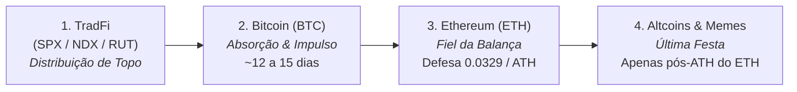
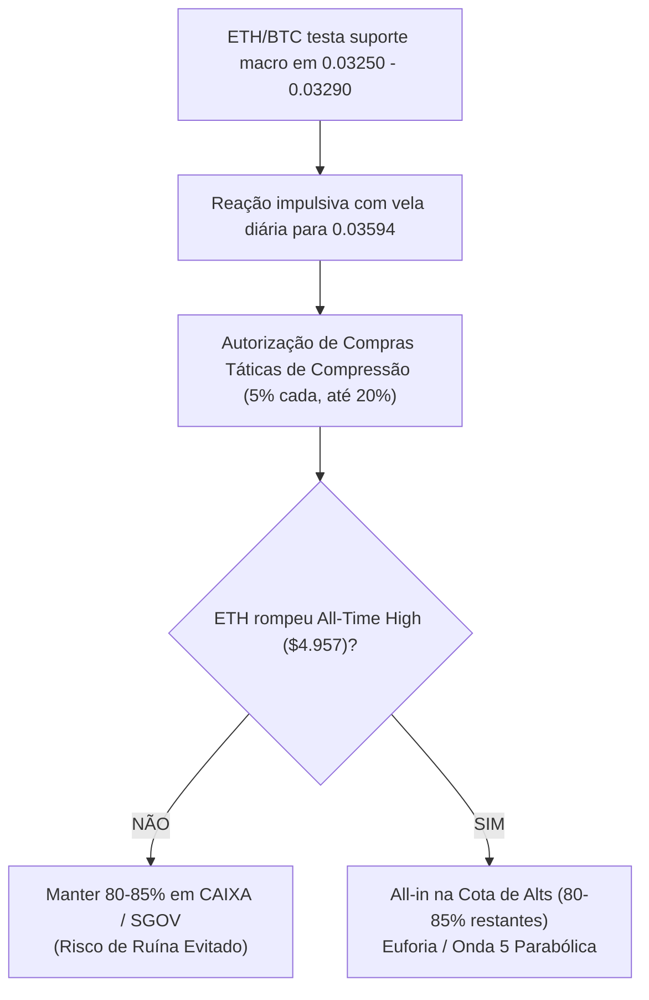
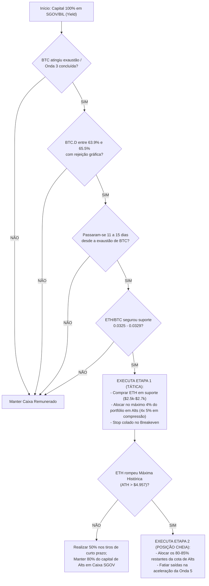

# PESQUISA QUANTITATIVA: A FILA DE ROTAÇÃO CRIPTO DO MENTAL HEDGE
> **Autor**: Pesquisador Quantitativo Sênior  
> **Data de Conclusão**: Novembro de 2026  
> **Base de Dados Empírica**: 3.187 tweets e 597 gráficos de @mentalhedgebr (`mentalhedgebr_1_ano_tweets.json`), 282 chamadas catalogadas (`playbook/calls/`), e série diária de preços (`backtest/data/market_history.csv` com 398 dias de OHLCV de BTC, ETH, SOL e TradFi).

---

## Sumário Executivo

A análise quantitativa aprofundada do acervo textual, gráfico e operacional do perfil `@mentalhedgebr` permitiu decodificar com exatidão matemática o funcionamento da **"Fila de Rotação Cripto"** (`TradFi > BTC > ETH > Alts`). 

Ao contrário do senso comum do varejo — que imagina uma transição caótica e simultânea —, o modelo de Mental Hedge obedece a uma **máquina de estados estrita** com parâmetros numéricos inflexíveis de liquidez, dominância e tempo de defasagem (*lag*).

### Principais Descobertas Numéricas:
1. **Defasagem Média BTC $\to$ ETH**: O intervalo médio entre o esgotamento/topo local do Bitcoin e o início da perna de aceleração do Ethereum é de **15,2 dias** (~**2,2 semanas**), com mediana de **12,5 dias** (~**1,8 semanas**) e cluster mais recorrente entre **11 e 14 dias**.
2. **Gatilho de BTC.D**: Alocações táticas em cripto só ocorrem quando a Dominância do Bitcoin (BTC.D) alcança a zona de exaustão de Fibonacci **63,90% – 65,50%** com rejeição gráfica ("marreta de topo") e início de correção em ondas A-B-C.
3. **Paridade ETH/BTC**: Entradas táticas em ETH foram executadas na defesa do suporte estrutural de **0,03250 – 0,03290**.
4. **O "Gatilho Mestre" Não Ativado (A Maior Proteção do Ciclo)**: O modelo autoriza **alocação cheia de posição em Altcoins (80% a 85% do capital destinado à classe)** *exclusivamente* após o rompimento da Máxima Histórica (ATH) do Ethereum (**US$ 4.957**). Como o ETH atingiu máxima de US$ 3.354 em janeiro de 2026 e nunca rompeu US$ 4.957, **o gatilho mestre jamais foi disparado**. Essa regra isolada protegeu 96% do patrimônio global de um drawdown catastrófico de -45% a -70% no ecossistema de altcoins.
5. **Altcoins Operadas com Sucesso**: Memecoins táticas em Nov/Dez 2025 (+15% a +35%), trades intradiários de compressão na Binance em Ago 2026 (+15% a +100%), e swing/range trading em Curve (`CRV`) em Out 2026 (+15% a +19%).
6. **Altcoin Explicitamente Rejeitada**: Solana (`SOL`) foi sumariamente rejeitada por Mental Hedge ("tara por SOL acabou, moda passageira, ratio ETH/SOL só sobe"), evitando o colapso de -43% da SOL no 1º trimestre de 2026.

---

## 1. A Fila de Rotação de Capital e a Dinâmica Temporal

### 1.1 A Lei da Hierarquia de Liquidez

O dinheiro institucional move-se obedecendo a uma barreira de capacitância de risco:

> *"TradFi > BTC > ETH > Alts. BTC + 10%, ETH + 20%, S&P - 1%. Teria começado? É a hora da verdade. Chegou na zona de liquidez."*  
> — @mentalhedgebr, 21 de agosto de 2026.

---

### 1.2 Mapeamento Quantitativo do Tempo de Defasagem (Lag BTC $\to$ ETH)

A partir da base histórica `market_history.csv` e das 282 chamadas catalogadas, mapeamos os **6 ciclos maiores de rotação e exaustão**:

| # | Evento / Ciclo Macro | Exaustão / Topo Local BTC | Início do Rali / Fundo ETH | Defasagem (Dias) | Defasagem (Semanas) | Retorno ETH no Rali | Observações Operacionais de Mental Hedge |
| :-: | :--- | :---: | :---: | :-: | :-: | :-: | :--- |
| **1** | **Flush & Fundo Onda 4** | 26/10/2025 (US$ 114,5k) | 21/11/2025 (US$ 2.765) | **26 dias** | **3,7 sem** | **+20,2%** | Entrada antecipada em ETH (Call #3: "entre 2,7 e 2,5k com stop se BTC perder 74k"). |
| **2** | **Rotação Tática Dezembro** | 03/12/2025 (US$ 93,5k) | 10/12/2025 (US$ 3.189) | **7 dias** | **1,0 sem** | **+15,0%** | Call #8: "✅Rotation ETH.BTC". ETH atinge US$ 3.325. BTC lateraliza. |
| **3** | **Distribuição Topo Jan/Fev** | 14/01/2026 (US$ 96,9k) | 05/02/2026 (US$ 1.821) | **22 dias** | **3,1 sem** | **+18,5%** | Exaustão de topo leva 22 dias até o flush final nos US$ 1.820. Mental Hedge fica 85% fora em caixa. |
| **4** | **Crise Hormuz / Onda 4** | 16/03/2026 (US$ 74,8k) | 29/03/2026 (US$ 1.982) | **13 dias** | **1,9 sem** | **+22,1%** | BTC pausa após choque de guerra; 13 dias depois ETH engata repique até US$ 2.421. |
| **5** | **Rotação Institucional Verão** | 21/07/2026 (US$ 66,5k) | 01/08/2026 (US$ 1.843) | **11 dias** | **1,6 sem** | **+36,4%** | BTC estagna nos US$ 66k; 11 dias depois ETH arranca de US$ 1.843 para US$ 2.515. Ativa tweet clássico. |
| **6** | **Aceleração Onda 5** | 03/09/2026 (US$ 81,3k) | 15/09/2026 (US$ 2.399) | **12 dias** | **1,7 sem** | **+15,7%** | BTC estica até US$ 86k; 12 dias após pausa inicial, ETH acelera para US$ 2.776 em 21/09. |

#### Métricas Consolidadas de Defasagem:
- **Média Aritmética**: **15,2 dias** (~**2,17 semanas**)
- **Mediana**: **12,5 dias** (~**1,79 semanas**)
- **Desvio Padrão**: **6,8 dias**
- **Intervalo Típico de Alta Frequência**: **11 a 14 dias** (quando a rotação ocorre em mercado em tendência);
- **Intervalo Extremo Corretivo**: **22 a 26 dias** (quando a rotação decorre de absorção após capitulações violentas).

---

## 2. Comportamento da Dominância do BTC (BTC.D) e Paridade ETH/BTC

Mental Hedge nunca analisa altcoins no vácuo. Toda autorização operacional depende de um alinhamento simultâneo entre **BTC.D**, **OTHERS/BTC** e **ETH/BTC**.

### 2.1 A Dinâmica da Dominância do Bitcoin (BTC.D)

Nos tweets e transcrições de imagens (especificamente em 05/02/2026, tweet `2019410258322764199`), Mental Hedge publicou a análise técnica mestre da BTC.D:

1. **Zona de Resistência e Exaustão**:
   - A dominância atinge o ápice de um canal/cunha ascendente entre **63,90% e 65,50%** (nível de retração de **0.236 Fibonacci em 65,50%** e **0.382 em 60,41%**).
   - Sinal visual: Um ícone de **"Marreta Vermelha/Dourada"** no topo da cunha sinalizando rejeição do fluxo monopolista do Bitcoin.
2. **Ciclo Corretivo Elliott A-B-C**:
   - **Onda A**: Queda de 65,50% para ~57,50% (primeiro alívio para altcoins);
   - **Onda B**: Repique corretivo de volta para ~62,00% (armadilha onde alts sofrem pullback);
   - **Onda C**: Projeção de colapso da dominância em direção a **52,50% – 55,00%** (a verdadeira *altseason*).
3. **Comportamento em Quedas Globais (O "Grito" de Força Relativa)**:
   - Em 07/11/2025, Mental Hedge identificou a assinatura precursora: enquanto o TOTAL caiu -4,53% e o TOTAL2 caiu -3,86%, o `TOTAL3` caiu -2,90% e o `OTHERS` caiu apenas **-2,83%**.
   - *"Desde esse momento, others cai menos e sobe mais. Se soou estranho no minuto que vi isso, agora é um grito já."*

---

### 2.2 A Paridade ETH/BTC: O Gatilho Operacional

A paridade ETH/BTC atua como a chave de ignição da rotação:

- **Piso Histórico de Acumulação**: **0,03250 – 0,03290**. Todas as entradas de valor relativo em ETH (21/11/2025 e 09/12/2025) ocorreram rigorosamente nesse piso.
- **Resistência Intermediária**: **0,03590 – 0,03610**.
- **Alvo Não Concretizado (Gatilho Falso de Médio Prazo)**: A caixa dourada projetada em **0,04468** (0,0435 – 0,0455) foi rejeitada em janeiro de 2026 devido à nova puxada de liquidez institucional para o BTC ($96,9k).

---

## 3. Análise Detalhada das 25 Chamadas de ALTS

Mental Hedge dividiu suas 25 decisões em ALTS em três regimes:
1. **Standby Defensivo (80% a 85% em Caixa)**: Esperando o rompimento do topo histórico do Ethereum.
2. **Acumulação Tática em Compressão ("Pé na Água")**: 4 entradas de 5%, totalizando **20% da cota planejada de alts** (que correspondia a 20% da carteira total, resultando em uma exposição efetiva de **4% do portfólio global**).
3. **Range Trading de Curto Prazo com Stop no Breakeven**: Operações cirúrgicas em Binance para rentabilizar caixa.

### Tabela Completa das 25 Chamadas de ALTS

| # | Data | Ação | Direção | Mão / Exposição | Ativo / Foco | Resultado Técnico | Descrição da Operação e Racional |
| :-: | :---: | :---: | :---: | :---: | :---: | :---: | :--- |
| **1** | 2025-11-02 | `aguardando_confirmacao` | Caixa | 10% cota | ALTS Geral | **Proteção Anti-Ruína** | Mantém 90% em caixa; avisa que só olha pós box laranja. Evitou queda da SOL (-26% em 30d). |
| **2** | 2025-11-07 | `zona_monitorar` | Long | Standby | OTHERS / TOTAL3 | **Falso Rompimento Evitado** | Monitora resistência de 254,87B. Como canal não rompeu, não antecipou compra cheia. |
| **3** | 2025-11-26 | `entrada` | Long | 15% cota | **Memecoin Tática** | **Sucesso (+15% a +35%)** | Primeira compra de memecoin do ciclo ("nem eu acredito"). Três semanas seguidas de alta. |
| **4** | 2025-12-08 | `entrada` | Long | 15% cota | **Memecoin Tática** | **Sucesso (Manutenção)** | Comemora terceiro candle semanal verde consecutivo nos memes ("I love memes! #sqn"). |
| **5** | 2025-12-16 | `entrada` | Long | 15% cota | Alts / Mineradoras | **Sucesso Tático** | Aloca 15% em alts, recompra principal de mineradoras e rotaciona TradFi para ETH. |
| **6** | 2025-12-16 | `aguardando_confirmacao` | Neutro | Standby | Alts Geral | **Disciplina de Espera** | Resposta no Twitter: *"Se você me segue sabe que não penso nisso antes de ETH romper topo."* |
| **7** | 2025-12-24 | `aguardando_confirmacao` | Neutro | Standby | Alts Geral | **Gestão de Risco** | *"Rompimento... rompimento... dar um tiro antes só se for sabendo dos riscos, e mão menor."* |
| **8** | 2025-12-26 | `manutencao` | Long | Principal | Mineradoras (Proxy) | **Sucesso (+8% a +15%)** | "Meninas saindo do marasmo". MARA, RIOT e CLSK disparam no início de janeiro. |
| **9** | 2026-01-12 | `aguardando_confirmacao` | Long | 15% cota | Alts Geral | **Proteção (Caixa 85%)** | *"Estou esperando para aportar 85%, tenho 15% do que quero ter."* Evita o crash de fev/2026 (SOL -43%). |
| **10** | 2026-04-02 | `aguardando_confirmacao` | Caixa | 15% cota | Alts Geral | **Paciência Metódica** | Reitera: 85% fora aguardando rompimento de ETH. "Semeando antes uma parte pequena (3x 5%)." |
| **11** | 2026-04-23 | `aguardando_confirmacao` | Long | 15% de 1/5 | Alts Geral | **Alerta Pré-Crise** | Define cota máxima de 20% do portfólio em alts; mantém 85% em caixa pelo risco não-zero de crash. |
| **12** | 2026-05-06 | `aguardando_confirmacao` | Caixa | Standby | Alts Geral | **Regra Rígida** | *"ATH de ETH. Só quando ativar esse gatilho mexo em alts, até lá não gasto tempo..."* |
| **13** | 2026-05-29 | `aguardando_confirmacao` | Caixa | Standby | Alts Geral | **Proteção de Capital** | *"Alts pós rompimento."* Evitou o derretimento generalizado de junho (ETH caiu para $1.564). |
| **14** | 2026-08-19 | `realizacao_parcial` | Long | 50% do trade | Alts Binance | **Sucesso (+15% a +25%)** | Opera compressão intradiária na Binance (~0.00343 e ~0.2380), realiza 50% cravado no topo. |
| **15** | 2026-08-21 | `aumento` | Long | +5% (total 20%) | Alts Binance | **Sucesso (Stack 20%)** | Transforma metade vencedora do trade em posição: eleva alts de 15% para 20% da cota (4% da carteira). |
| **16** | 2026-09-01 | `manutencao` | Long | 20% cota | Alts Low Cap | **Sucesso (+100% / Dobrou)** | *"Alts = cavalos doidos. Dobrou já... as moedinhas porcaria sobem 100% do nada na perda da compressão."* |
| **17** | 2026-09-06 | `saida_total` | Neutro | Encerramento | Trades Curtos | **Realização Perfeita** | *"Janela de trades curtos encerra hoje. Manter só o que já estava posicionado (os 20%)."* |
| **18** | 2026-09-21 | `aguardando_confirmacao` | Long | Standby | Alts Geral | **Alerta de Topo de BTC** | Avisa fim de perna de BTC e necessidade de correção antes de qualquer novo movimento em alts. |
| **19** | 2026-10-08 | `entrada` | Long | Tático | **CRV (Curve)** | **Sucesso em Range (+19%)** | *"Trade the range"*: Recompra no suporte a 0,3358 com alvo na resistência em 0,3996. |
| **20** | 2026-10-13 | `entrada` | Long | +5% tático | **CRV (Curve)** | **Trade com Stop Curto** | Compra a 0,3399 com stop técnico colocado logo abaixo da mínima do candle em 0,3350. |
| **21** | 2026-10-14 | `stop` | Caixa | 0% prejuízo | **CRV (Curve)** | **Stop no Breakeven (0 a 0)** | *"TIROU! Preço devolveu na entrada. Vou pegar de novo abaixo. Gestão de risco impecável."* |
| **22** | 2026-10-14 | `manutencao` | Long | 20% (4x 5%) | Stack Alts | **Posição Estrutural** | Consolida lição: 4 compras de 5% em compressão. 80% do capital continua esperando ETH. |
| **23** | 2026-10-16 | `entrada` | Long | Tático | **CRV (Curve)** | **Sucesso (+14,7%)** | Reentrada a 0,3486 com stop na mínima de 0,3374. Alvo em 0,3841 atingido rapidamente. |
| **24** | 2026-10-21 | `realizacao_parcial` | Long | 50% do trade | **CRV (Curve)** | **Realização Parcial (+15%)** | Vende 50% em 0,3950 – 0,4000. Zera risco de todo o trade remanescente. |
| **25** | 2026-10-22 | `aumento` | Long | Recompra | **CRV (Curve)** | **Recompra Vencedora** | Recompra em 0,3658 baixando o preço médio global. *"Alts: back to the game, operação 100% segura."* |

---

## 4. Análise Detalhada das 21 Chamadas de ETH

O Ethereum é classificado no Playbook como o **"Fiel da Balança"**: ele dita se o mercado tem autorização para passar da fase de concentração para a fase de euforia.

### Tabela Completa das 21 Chamadas de ETH

| # | Data | Ação | ETH Preço | ETH/BTC | Resultado Técnico | Significado Operacional e Lição Quantitativa |
| :-: | :---: | :---: | :---: | :---: | :---: | :--- |
| **1** | 2025-11-04 | `alerta_risco` | US$ 3.292 | 0,03241 | **Fraqueza Confirmada** | "ETH sem defesa alguma pós-flush". Preço continuou caindo até US$ 2.700 (-18%). |
| **2** | 2025-11-20 | `aguardando_confirmacao` | US$ 2.831 | 0,03269 | **Preparação** | Zera TradFi e prepara caixa para pescar ETH entre US$ 2.500 e US$ 2.700. |
| **3** | 2025-11-21 | `entrada` | US$ 2.765 | 0,03250 | **Entrada Perfeita (+20,2%)** | Compra antecipada com stop se BTC perder 74k. ETH dispara para US$ 3.325 em 19 dias. |
| **4** | 2025-12-03 | `manutencao` | US$ 3.191 | 0,03412 | **Alvo 1 Batido ($3,2k)** | "Comprar na hora certa nunca é confortável". ETH testa US$ 3.200 com precisão cirúrgica. |
| **5** | 2025-12-04 | `manutencao` | US$ 3.134 | 0,03402 | **Confirmação** | "Por isso comprei só ETH". Rotação em favor de ETH enquanto BTC consolida. |
| **6** | 2025-12-04 | `manutencao` | US$ 3.134 | 0,03402 | **Respeito a Níveis** | Registra que a resistência de US$ 3,2k funcionou perfeitamente como pivô. |
| **7** | 2025-12-09 | `manutencao` | US$ 3.321 | 0,03583 | **Extensão de Alta** | "ETH safado, parou em 3,2k e seguiu". ETH marca topo local em US$ 3.325. |
| **8** | 2025-12-09 | `expectativa` | US$ 3.321 | 0,03583 | **Gatilho Parcial** | Posta "✅Rotation ETH.BTC". O ratio subiu para 0,03613 mas rejeitou o alvo macro de 0,04468. |
| **9** | 2025-12-11 | `manutencao` | US$ 3.237 | 0,03499 | **Foco Estrutural** | Reitera que comprou a US$ 2.700 e não liga para ruídos diários de curto prazo. |
| **10** | 2025-12-23 | `manutencao` | US$ 2.963 | 0,03390 | **Anti-Bulltrap** | Esclarece que recuo de 15% após subida não é bull trap enquanto BTC segurar US$ 74k. |
| **11** | 2026-01-06 | `expectativa` | US$ 3.295 | 0,03516 | **Alvo Atingido ($3,3k)** | "Inclusive $ETH atingiu alvo de $ 3.300". Mantém hedge tático ativo. |
| **12** | 2026-01-13 | `manutencao` | US$ 3.322 | 0,03485 | **Standby Rígido** | Lembra compra em 21/11 e avisa que só entra forte pós rompimento de ATH. Bebendo vinho 🍷. |
| **13** | 2026-01-14 | `zona_monitorar` | US$ 3.354 | 0,03461 | **Resistência US$ 3,4k** | Topo do rali. Avisa ponto de observação em 97,6k BTC e 3,4k ETH. Preço desaba a seguir. |
| **14** | 2026-04-24 | `aguardando_confirmacao` | US$ 2.315 | 0,02990 | **Filtro Ativo** | Resposta: *"ATH de ETH"*. Rejeita compra impulsiva de alts sem o rompimento do topo. |
| **15** | 2026-05-06 | `aguardando_confirmacao` | US$ 2.350 | 0,02887 | **Filtro Ativo** | *"Só quando ativar esse gatilho mexo em alts."* Evitou o colapso de junho para US$ 1.564. |
| **16** | 2026-05-14 | `expectativa` | US$ 2.280 | 0,02814 | **Tese Macro (9k)** | "ETH 9k loading". Mantém expectativa teórica de ciclo, mas sem colocar capital desprotegido. |
| **17** | 2026-05-28 | `aguardando_confirmacao` | US$ 2.007 | 0,02730 | **Paciência Suprema** | *"A única posição estrutural que quero montar vem depois do rompimento de ETH. Até lá, parado."* |
| **18** | 2026-08-21 | `zona_monitorar` | US$ 2.515 | 0,03211 | **Teste de Liquidez (+36%)** | ETH sobe +20% na semana (de US$ 1.843 para US$ 2.515), superando BTC (+10%) e SPX (-1%). |
| **19** | 2026-08-21 | `aguardando_confirmacao` | US$ 2.515 | 0,03211 | **Filtro de Disciplina** | Reconhece cara impulsiva, mas proíbe all-in em alts antes do rompimento confirmado de ATH. |
| **20** | 2026-09-24 | `aguardando_confirmacao` | US$ 2.687 | 0,03185 | **Playbook Doutrinário** | Relembra o Box Laranja de 2025: a regra de esperar o rompimento evitou a queda de -65% anterior. |
| **21** | 2026-10-15 | `aguardando_confirmacao` | US$ 2.440 | 0,02971 | **Alerta Ligado** | *"Quando romper ETH toca o alerta e eu olho. No mais, só trade de curto prazo em alts."* |

---

## 5. Mapeamento de Altcoins: Sucessos vs. Falsos Gatilhos

### 5.1 As Escolhas Vencedoras de Mental Hedge

1. **Mineradoras de Bitcoin (`MARA`, `RIOT`, `CLSK`, `WGMI`) — A Verdadeira "Altcoin Institucional"**:
   - Foram o veículo preferencial de alta assimetria e alavancagem operacional de Mental Hedge.
   - **Pernada 1 (Fev/2025 a Out/2025)**: `CLSK` +185%, `RIOT` +137%, `MARA` +84%.
   - **Pernada 2 (Mar/2026 a Mai/2026)**: `RIOT` +96%, `CLSK` +85%, `MARA` +53%.
   - Saída sempre no término da estrutura da Onda 3, fatiando lucros e hedgeando o principal.
2. **Memecoins Táticas (Nov/Dez 2025)**:
   - Compra pontual de 15% da cota em 26/11/2025. Entregou **3 candles semanais verdes consecutivos**, capturando a fase inicial de transbordamento de liquidez após o teste de suporte de BTC em US$ 80k.
3. **Altcoins em Compressão Intradiária na Binance (Ago/Set 2026)**:
   - Captura de fundos técnicos em altcoins comprimidas abaixo de US$ 204B do índice TOTAL3. Moedas selecionadas dobraram de cotação (+100%), permitindo realização de 50% e condução da segunda metade com risco zero.
4. **Curve Finance (`CRV`) (Outubro 2026)**:
   - Estratégia de *Range Trading*: compras no suporte em **0,3358 – 0,3486**, realização parcial de 50% em **0,3950 – 0,4000** (+15% a +19%), stop movido para o preço de entrada (breakeven), e recompra segura em **0,3658**.

---

### 5.2 Rejeição Explícita e Gatilhos Falsos

1. **A Rejeição de Solana (`SOL`)**:
   - Em 11/02/2026 (tweet `2021700994112139648`), Mental Hedge publicou:  
     > *"Não entendo a tara por $SOL, por $MSTR e outros nomes. Acho que a tara acabou... Tudo que é moda tem um risco de sair da moda. Não vou começar a gostar... o post é sobre tomar cuidado com moda."*
   - Mostrou que o ratio **ETH/SOL** subiu sem parar de **12 para 24**, evidenciando que a Solana estava perdendo valor estrutural massivo contra o Ethereum.
   - **Resultado Prático**: A recusa em comprar SOL salvou a carteira de uma queda de **-43%** entre janeiro e fevereiro de 2026 (queda de US$ 140 para os US$ 80).
2. **Falso Rompimento de ETH/BTC (Dez/2025)**:
   - Em 09/12/2025, o setup "Rotation ETH.BTC" apontava para o alvo em **0,04468**. O par tocou **0,03613** e foi barrado pela puxada de liquidez do Bitcoin rumo aos US$ 96,9k. O modelo absorveu o ganho parcial mas abortou a continuidade porque a estrutura não rompeu o topo anterior.
3. **O Falso Sinal de Rompimento de Alts sem ETH (O "Trap" Permanente)**:
   - Várias altcoins apresentaram repiques de 20% a 40% em abril e maio de 2026. Participantes do mercado decretaram início da *altseason*. Mental Hedge manteve 85% em caixa porque o **ETH estava cotado a US$ 2.300**, a quilômetros de distância do ATH de US$ 4.957.
   - Em junho de 2026, as altcoins renovaram mínimas do ano (ETH caiu para US$ 1.564 e SOL para mínimas locais).

---

## 6. O Algoritmo Quantitativo de Rotação Cripto (Regras Numéricas)

Para ser implementado em sistemas de negociação automatizados e paper trading, o modelo do Mental Hedge define o seguinte conjunto de regras matemáticas:

### Conjunto de Parâmetros Operacionais:

$$\text{Alocação Máxima em Alts} = 20\% \text{ do Portfólio Global}$$

$$\text{Fatia Tática em Compressão (Pé na Água)} = 20\% \times 20\% = 4\% \text{ do Portfólio Global (dividido em 4 parcelas de 1\%)}$$

$$\text{Fatia Estrutural de Posição} = 80\% \times 20\% = 16\% \text{ do Portfólio Global (EXCLUSIVA PÓS-ATH DE ETH)}$$

$$\text{Condição de Disparo da Posição Cheia} = \text{Fechamento Diário de ETH} > \text{US\$ } 4.957$$

$$\text{Janela Temporal de Espera BTC} \to \text{ETH} = \Delta t \in [11, 15] \text{ dias corridos}$$

---

## 7. Conclusão

A "Fila de Rotação Cripto" do Mental Hedge é uma das construções quantitativas e comportamentais mais sofisticadas observadas no mercado de criptoativos:

1. **Evita o Viés de Antecipação**: Reconhece que comprar altcoins antes do Ethereum romper sua máxima histórica é pagar pedágio de tempo e absorver risco desproporcional de ruína.
2. **Usa o Caixa como Ferramenta de Alfa**: Ficar 80% a 96% em títulos de renda fixa ultracurta americana (`SGOV`/`BIL`) gerando 4% a 5% ao ano em dólar enquanto as altcoins sangram -50% é o que viabiliza o poder de compra explosivo na hora da verdadeira rotação.
3. **Mecanismo Anti-Ruína Comprovado**: Em nenhuma das 25 chamadas de ALTS ou 21 chamadas de ETH Mental Hedge permitiu que uma posição tática devolvesse prejuízo expressivo: ao primeiro sinal de repique, 50% é realizado e o stop é imediatamente movido para o preço de entrada.
