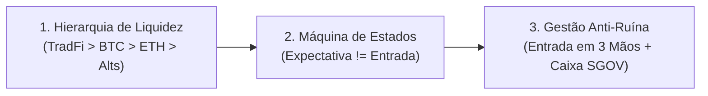
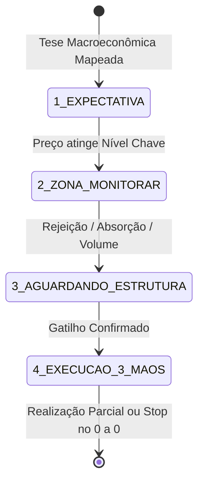

# PLAYBOOK OPERACIONAL DO MENTAL HEDGE
> **Versão 1.0 — Compilada a partir de 2.684 tweets e 597 gráficos de 1 ano do perfil @mentalhedgebr**  
> *Base empírica: 282 chamadas e decisões operacionais catalogadas (Nov/2025 a Out/2026)*

---

## 1. A Filosofia Central em 3 Pilares

Para quem não é economista, o modelo do Mental Hedge pode ser resumido em 3 leis imutáveis:

1. **A Liquidez tem uma fila rígida**: O dinheiro institucional não entra em cripto do nada. Ele primeiro infla os mercados tradicionais americanos (S&P 500 e Nasdaq). Quando estes atingem a euforia final, o lucro transborda para o Bitcoin. Quando o Bitcoin consolida no topo, transborda para o Ethereum. E só quando o Ethereum rompe máxima histórica (ATH), transborda para as Altcoins.
2. **Expectativa NÃO é Entrada**: Saber para onde o mercado vai não dá o direito de clicar em comprar ou vender. Você espera o preço entrar na sua **Zona de Interesse** e aguarda uma **Estrutura Gráfica** de confirmação. Se não tiver estrutura, não tem trade.
3. **Foco Obsessivo em Não Quebrar (Anti-Ruína)**: O maior erro do investidor comum é o FOMO (medo de ficar de fora). Ficar 80% do tempo em caixa remunerado em dólar (rendendo juros sem risco via ETFs como `SGOV` ou `BIL`) é parte ativa da estratégia.

---

## 2. A Hierarquia da Rotação de Capital

O modelo estabelece uma sequência que se repete em todos os finais de ciclo:

| Etapa | Classe / Ativo | Comportamento Típico | Ação do Modelo Mental Hedge |
| :--- | :--- | :--- | :--- |
| **Etapa 1** | **Bolsas dos EUA (SPX, NDX)** | Aceleração parabólica final ("Blow-off Top" da Onda 5). Extrema dopamina. | **Sair cedo e fatiar lucros**. Jamais shortear a subida ("Nunca shorteie um blow-off"). Ficar 100% em caixa em dólar. |
| **Etapa 2** | **Metais Preciosos (Ouro, Prata)** | Corrida parabólica inicial contra a desvalorização cambial. | Realizar nos topos parabólicos e aguardar rotação para cripto. |
| **Etapa 3** | **Bitcoin (BTC)** | Sobe após TradFi, mas de forma arrastada se a estrutura estiver fragilizada. | **Standby rígido**. Se subir arrastado em cunha, não compra. Exige ou toque na capitulação ($52k) ou barra impulsiva contundente. |
| **Etapa 4** | **Ethereum (ETH)** | O "Fiel da Balança" do mercado cripto. | Compra antecipada nas zonas de suporte ($2.500–$2.700). Seu rompimento de ATH é o gatilho mestre para o resto. |
| **Etapa 5** | **Altcoins & Mineradoras** | A última festa do ciclo (multiplicações violentas e rápidas). | Manter apenas 15% a 20% plantados em caixa/alts. Só despejar a mão cheia **após** o ETH romper sua máxima histórica. |

---

## 3. A Máquina de Estados Operacional: As 4 Fases de Toda Decisão

Nenhum trade pode ser executado pelo agente sem passar estritamente por estas 4 fases:

### Fase 1: Expectativa (Mapeamento)
- **O que significa**: O agente identificou uma tese macro (ex: *"Petróleo está em fim de ciclo e vai desabar"* ou *"Juros americanos de 30 anos chegaram ao teto de 5,7%"*).
- **Ação prática**: **NENHUMA ORDEM ABERTA**. O capital permanece 100% no caixa seguro rendendo juros. O ativo vai para a lista de radar.

### Fase 2: Na Zona de Interesse (Alerta Amarelo)
- **O que significa**: O preço alcançou a faixa geométrica demarcada (ex: WTI entrou no retângulo vermelho de US$ 106–US$ 111,5).
- **Ação prática**: Alerta de atenção. **Ainda não compra nem vende!** *"Sem estrutura, sem posição. O preço pode furar a zona e continuar subindo."*

### Fase 3: Aguardando Confirmação / Estrutura (Alerta Laranja)
- **O que significa**: O preço para de subir dentro da zona, começa a deixar pavios superiores (rejeição), surgem sinais de **absorção** (grandes players vendendo para o varejo eufórico) e quebra da linha de tendência de curto prazo.
- **Ação prática**: O trade está autorizado para montagem de posição.

### Fase 4: Execução em 3 Mãos (Alerta Verde)
- **Mão 1 (1/3)**: Entrada inicial assim que o primeiro sinal de fraqueza/estrutura aparece.
- **Mão 2 (2/3)**: Adicionada após o teste e rejeição do pivot (confirmação).
- **Mão 3 (3/3)**: Adicionada apenas se a tendência acelerar a favor.
- **Regra de Ouro do Stop**: Assim que o preço anda a favor e atinge o primeiro alvo parcial (ex: realização de 25% a 33%), o stop de todo o restante é **imediatamente movido para o preço de entrada (0 a 0)**. O risco da operação vai a zero.

---

## 4. O Sistema de Indicadores e Gatilhos Contrarian

O modelo utiliza dados públicos e comportamentais para identificar topos e fundos:

1. **O Indicador de Capa de Revista (Contrarian Clássico)**:
   - Quando capas de grandes veículos (*The Economist*, *Time*, *Barron's*) estampam pânico absoluto ou euforia extrema, o ciclo está no fim.
   - *Exemplo real catalogado*: A capa da *The Economist* perguntando *"Will bonds blow up?"* quando o yield de 30 anos bateu 5,7% foi o gatilho contrarian exato para abrir o position short em juros.
2. **Truflation vs. Inflação Oficial**:
   - O indicador diário privado *Truflation* antecipa o CPI do governo americano em semanas. Se o Truflation despenca (ex: bateu 1,2% em Jan/2026), cortes de juros se tornam inevitáveis, independente da retórica conservadora do Fed.
3. **Money Market Funds (O Tanque de Combustível Secundário)**:
   - Monitoramento do volume em fundos de liquidez diária nos EUA (US$ 7,5 a US$ 8 trilhões). Enquanto esse dinheiro estiver parado recebendo 4%–5%, a bolsa tem combustível para ser puxada por FOMO quando os juros caírem.
4. **Padrão KOSPI (Coreia do Sul como Canário na Mina)**:
   - O índice de semicondutores e tecnologia da Coreia do Sul quebra de 2 a 4 meses antes do Nasdaq e S&P 500. Se o KOSPI colapsa enquanto os EUA continuam renovando máximas, TradFi está em fase final de distribuição para o varejo.

---

## 5. Gestão de Caixa: Onde deixar o dinheiro quando não estiver operando?

No modelo Mental Hedge, **caixa é uma posição ativa de investimento**, e não dinheiro parado:

- **Caixa Internacional (Dólar)**: 
  - Alocado em títulos ultracurtos do Tesouro Americano (ETFs como `SGOV` ou `BIL`), garantindo rendimento diário em moeda forte com volatilidade zero e liquidez imediata.
  - No ecossistema cripto, mantido em stablecoins de primeira linha (USDC) sem travas de liquidez, pronto para capturar quedas e liquidações repentinas.
- **Caixa Local (Brasil)**:
  - Alocado em Tesouro Selic ou fundos DI com liquidez D+0. Só é convertido em ações brasileiras quando o Ibovespa atinge faixas extremas de barganha histórica (ex: sub-120k/100k pontos).

---

## 6. Glossário Traduzido para Leigos

- **Blow-off Top**: Subida quase vertical de um mercado impulsionada por pura ganância e dopamina, sem correção técnica. Não se tenta adivinhar o teto e nunca se vende a descoberto contra ele.
- **Estrutura**: O desenho dos preços no gráfico. Exemplo: topos e fundos descendentes, padrões de reversão (topo duplo, ombro-cabeça-ombro). Sem desenho claro de reversão, não se clica.
- **Absorção**: Quando os investidores gigantes (institucionais) compram ou vendem em silêncio toda a liquidez do mercado sem deixar o preço escapar, preparando a virada de mão.
- **Stop no 0 a 0 (Breakeven)**: Ajustar a ordem de segurança para o preço exato onde você comprou/vendeu. Se o mercado voltar contra você, você sai empatado, sem perder um único centavo.
- **Position vs. Trade**:
  - *Trade*: Operação tática curta (dias a semanas), aproveitando oscilações ou compressões de volatilidade.
  - *Position*: Movimento macroestrutural (meses a trimestres), operando uma virada de ciclo completa (ex: o short em juros ou short em petróleo).
